# Orion Mobile, l'app Android

Orion Mobile è il telefono in tasca di chi agisce: il volontario in squadra, il
magazziniere che consegna, la segreteria fuori sede. Parla con lo stesso
server del web e vede gli stessi dati. Per il lavoro in sala operativa c'è il
[manuale del web](manuale-web.md).

Le immagini vengono da un gruppo di prova, il "Gruppo Comunale di Protezione
Civile", con persone e dati inventati. Come sul web, ognuno vede solo le voci
del suo ruolo.

## 1. Installare ed entrare

L'app non sta nel Play Store: la distribuisce l'associazione dal proprio
server. Dal browser del telefono, dopo l'accesso al web, ORION propone
"Scarica l'app" e spiega i passi: scaricare `orion.apk`, aprirlo dalla
notifica, consentire una volta l'installazione da quella fonte, toccare
"Installa".

**Il primo accesso, tutto dal telefono.** Chi viene iscritto riceve un link
(per email o su un foglio con un QR). Aperto sul telefono, il link propone
**Continua nell'app**; se l'app non c'è ancora, la pagina spiega come
installarla, poi si torna lì e si tocca di nuovo. Il QR del foglio si può
anche inquadrare dall'app, con **Accedi con un QR**. Nell'app si sceglie la
password, si accettano le condizioni d'uso e si lascia acceso **Conferma gli
accessi da questo telefono** (per amministratori e segreteria sanitaria è
obbligatorio). Seguono i dieci **codici di riserva**, da salvare fuori dal
telefono con "Condividi o stampa", e la proposta dell'impronta.

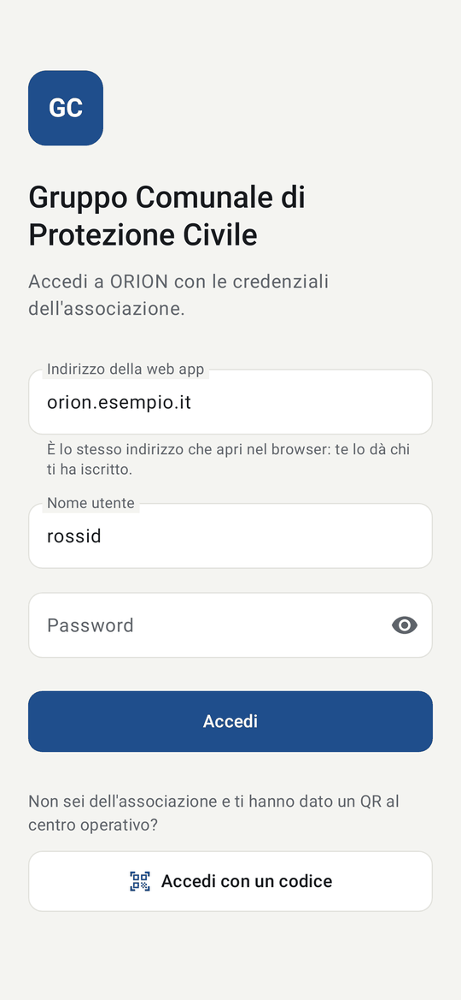

Chi ha già un account scrive l'indirizzo della web app (lo stesso del
browser), il nome utente e la password. Se il telefono è collegato, la
verifica in due passaggi è solo l'impronta o il PIN; altrimenti si conferma da
un altro telefono collegato, con il codice a sei cifre o con un codice di
riserva. Chi la deve avere e non l'ha ancora tocca **Collega questo
telefono**. Subito dopo l'app propone di entrare la volta dopo con
l'**impronta**: conviene accettare, e la password non resta sul telefono.
Dopo cinque password sbagliate di fila l'account si ferma per qualche minuto,
e il messaggio dice quanto aspettare.

Chi non è dell'associazione e ha ricevuto un QR dal centro operativo usa
**Accedi con un QR** e lo inquadra. Chi ha già ORION con la propria
associazione non deve uscire: in fondo alla home tocca **Entra in un altro
ORION** e inquadra il QR (oppure lo inquadra con la fotocamera del telefono e
tocca «Apri nell'app»). L'app chiede conferma ed entra come esterno; il
proprio ORION resta in pausa (i suoi avvisi non arrivano finché non si torna)
e la home lo ricorda con **Torna al tuo ORION**. Quando l'emergenza dell'altro
centro operativo si chiude, o l'accesso viene revocato, l'app torna da sola
nel proprio ORION, con l'impronta e le azioni rimaste in coda come prima.

Poi l'app chiede i permessi, uno alla volta: le **notifiche** (per sapere quando
si viene chiamati o mandati su un intervento), la **fotocamera** (foto e
documenti) e la **posizione**, da concedere come "Consenti sempre": così la
sala vede la squadra anche con il telefono in tasca.

## 2. La schermata principale

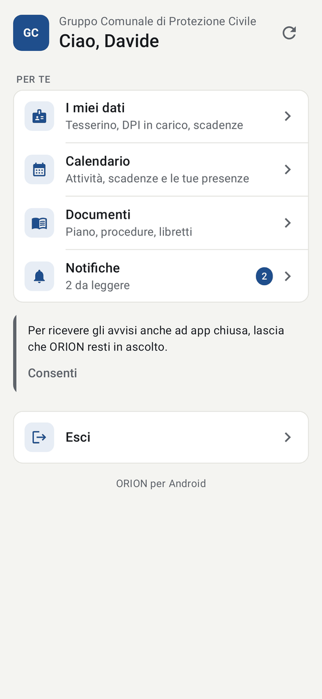

In alto il nome dell'associazione e il saluto; il pulsante tondo aggiorna. Le
voci sono divise in due gruppi.

| Voce | Cosa contiene | Chi la vede |
|---|---|---|
| Le mie attività | Gli incarichi della propria funzione di supporto | Chi è in una funzione, durante l'emergenza |
| Regia: osservazioni | Gli appunti della regia in una simulazione | La regia, a sala aperta |
| I miei dati | Tesserino, DPI in carico, visite, corsi, profilo | Tutti gli interni |
| Calendario | Attività, convocazioni, presenze, assenze | Tutti gli interni |
| Documenti | Piano, procedure, libretti | Tutti |
| Notifiche | Gli avvisi ricevuti | Tutti |
| Consegna materiale | Consegna a una persona | Chi consegna |
| Rientro materiale | Il materiale che torna in magazzino | Chi consegna |
| Magazzino | Inventario, scadenze, chi ha cosa, registro | Chi gestisce il magazzino |
| Segreteria | Scadenze, fascicoli, visite e corsi | Chi gestisce visite e corsi |
| Esci | Esce dall'app e ferma gli avvisi | Tutti |

Sotto le voci, un riquadro segnala quello che va sistemato: per esempio la
posizione non concessa "sempre", o gli avvisi da attivare. Toccandolo si arriva
dove si sistema.

## 3. L'emergenza

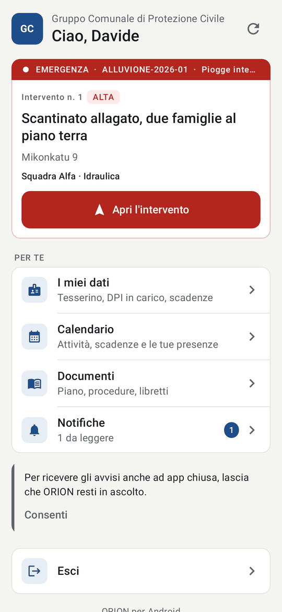

L'emergenza compare solo a chi è in una squadra. In cima c'è la fascia rossa con
il codice; sotto, il riquadro dell'intervento della propria squadra, con
"Apri".

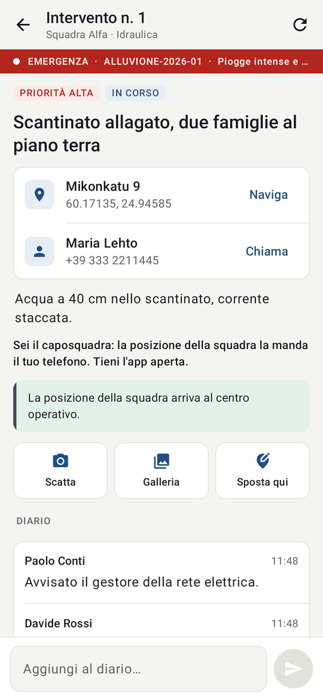

La schermata dell'intervento dice tutto quello che serve sul posto: priorità,
stato e tipo (allagamento, albero, frana...), l'indirizzo con **Naviga** (apre
il navigatore), chi ha chiamato con **Chiama**, la descrizione, i rischi e il
diario. **Scatta** e **Galleria** aggiungono foto; **Sposta qui** corregge il
punto sulla mappa con la posizione del telefono. In fondo si scrive nel
diario. Note e foto partono anche senza rete: restano in coda e arrivano
appena torna il campo.

Sotto l'indirizzo ci sono quattro pulsanti grandi: **Partiti**, **Sul posto**,
**Concluso**, **Rientrati**. È acceso solo il passo successivo, così un tocco
per sbaglio non salta avanti; quelli già fatti hanno la spunta. La sala vede
subito a che punto è la squadra, e nel diario compare "Alfa sul posto, 14:32".
Senza rete il tocco va in coda come le note, il pulsante mostra la clessidra e
quando torna il campo arriva con l'ora in cui lo si è toccato, non con quella
dell'arrivo. "Concluso" vuol dire che la squadra ha finito: la segnalazione la
chiude la sala.

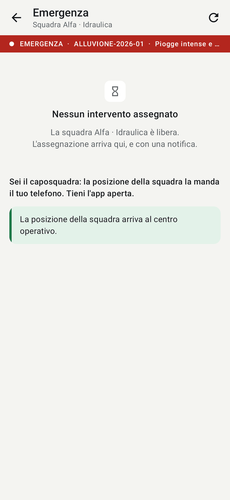

Quando la squadra è libera la schermata lo dice e aspetta. L'assegnazione
arriva con una notifica.

**La posizione.** Mentre si è in squadra l'app manda la posizione alla sala.
Se c'è un caposquadra la manda il suo telefono; se tace per qualche minuto
subentra quello di un altro membro. Smette da sola uscendo dalla squadra o alla
chiusura dell'emergenza.

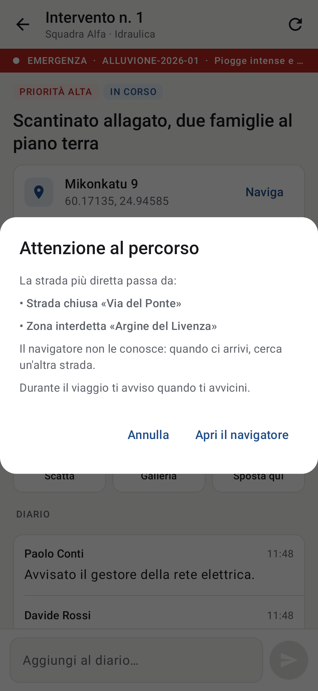

**Strade chiuse e zone interdette.** Il navigatore del telefono non sa quali
strade ha chiuso la sala. Per questo **Naviga**, prima di aprirlo, controlla
se la strada più diretta passa da una strada chiusa o da una zona interdetta:
se sì lo dice, e si parte sapendo dove cambiare strada. Il controllo si fa
solo se sulla mappa dell'emergenza c'è almeno una strada chiusa o una zona
interdetta, e chiede il percorso allo stesso servizio che usa la mappa della
sala (OSRM), con le sole coordinate di partenza e di arrivo. Senza rete o
senza la posizione del telefono lo dice e apre il navigatore.

Durante il viaggio, mentre la posizione è condivisa, il telefono avvisa da sé:
con una vibrazione e una frase detta a voce quando ci si avvicina (cento metri
da una zona interdetta, ottanta da una strada chiusa che si ha davanti), con un
allarme che suona anche col telefono in silenzioso quando si entra in una zona
interdetta. La sala riceve lo stesso avviso. Se nella zona c'è l'intervento
della squadra entrarci è il lavoro previsto: l'avviso è calmo, senza allarme,
e non si avvisa avvicinandosi. Lo stesso per una strada chiusa su cui si trova
l'intervento. Le zone restano sul telefono, così gli avvisi arrivano anche
dove manca la rete. Le notifiche hanno due voci nelle impostazioni del
telefono, "Strade chiuse e zone vicine" e "Ingresso in zona interdetta": si
possono silenziare, ma in emergenza conviene di no.

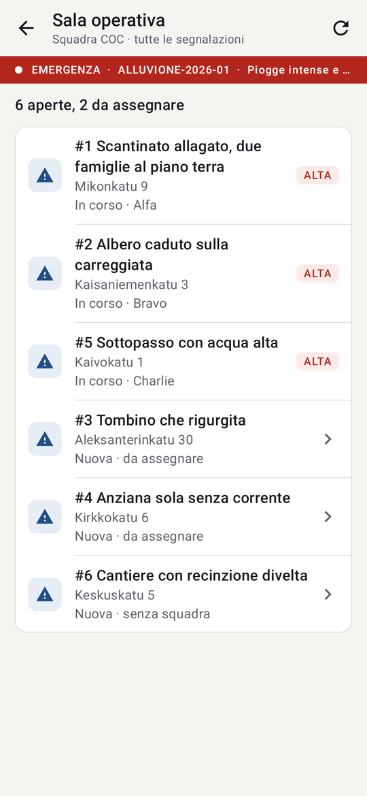

**Chi è in sala** (squadra COC) e chi apre le emergenze (coordinatore e
amministratore, anche fuori dalla sala: nella schermata principale c'è la voce
**Sala operativa**) vede dal telefono tutte le segnalazioni aperte, le apre,
legge il diario e scrive note. In cima tre numeri: le aperte, quelle da
assegnare e quelle senza squadra da più dei minuti critici della sala. Sotto
l'elenco ci sono le squadre con il loro impegno e lo stato (partita, sul
posto...); toccando una squadra impegnata si apre la sua segnalazione. Le
squadre che vengono da fuori hanno davanti la sigla della loro qualifica
("VVF Bravo", "PL Charlie").

**Squadre.** Il coordinatore, l'amministratore e chi è nella squadra COC
trovano fra gli strumenti la voce **Squadre**, con un'emergenza aperta e anche
fuori. Toccando una squadra se ne vedono i membri: **Capo** nomina il
caposquadra, **Togli** fa uscire una persona, e sotto si cerca per nome fra chi
è senza squadra e si tocca **Aggiungi**. **Sciogli la squadra** si può solo
quando è libera dall'intervento. **Nuova squadra** chiede il nome radio, fra
quelli liberi, e una descrizione facoltativa. Senza rete le squadre si vedono
come all'ultima lettura ma i comandi sono spenti: cambiare le squadre senza
che la sala lo veda farebbe confusione.

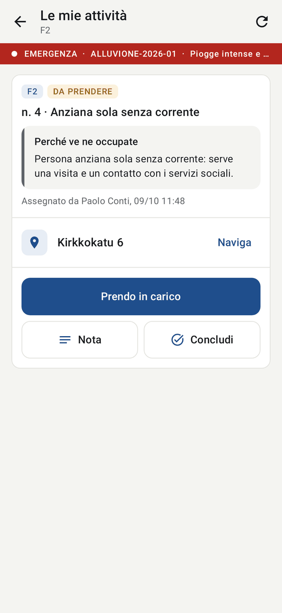

**Le mie attività** è per chi fa parte di una funzione di supporto. Ogni
incarico dice perché è stato dato e dove: **Prendo in carico**, **Nota** (scrive
nel diario con la sigla della funzione) e **Concludi** con l'esito. Qui serve la
rete.

### Orion Voice

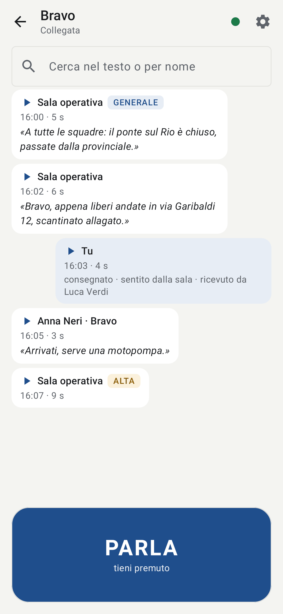

Se l'associazione ha acceso Orion Voice, durante un'emergenza chi è in squadra
parla con la squadra e con la sala tenendo premuto **PARLA**, come con la
radio. In fondo a ogni schermata compare una barra con il canale, chi sta
parlando e un PARLA piccolo; toccando il nome del canale si apre la schermata
di Orion Voice, con i messaggi del canale. Un tocco su un messaggio lo riascolta,
tenendolo premuto lo riascolta più veloce. Se l'associazione ha acceso la
trascrizione, sotto ogni messaggio compare anche il testo, tra virgolette: è
automatico e può sbagliare, l'audio resta da ascoltare. La casella in cima
cerca nei testi e nei nomi. I messaggi stanno nell'ordine in cui sono stati
detti, anche quelli registrati senza rete e arrivati dopo. Anche i propri si
riascoltano con un tocco, e dicono a che punto sono: in invio, consegnato,
sentito dalla sala, ricevuto da chi ha confermato. Tutti sentono il canale **Generale** e gli avvisi della sala: i
loro messaggi compaiono fra quelli della squadra, con il nome del canale. Il
caposquadra sul Generale può anche parlare, scegliendolo sopra il tasto.

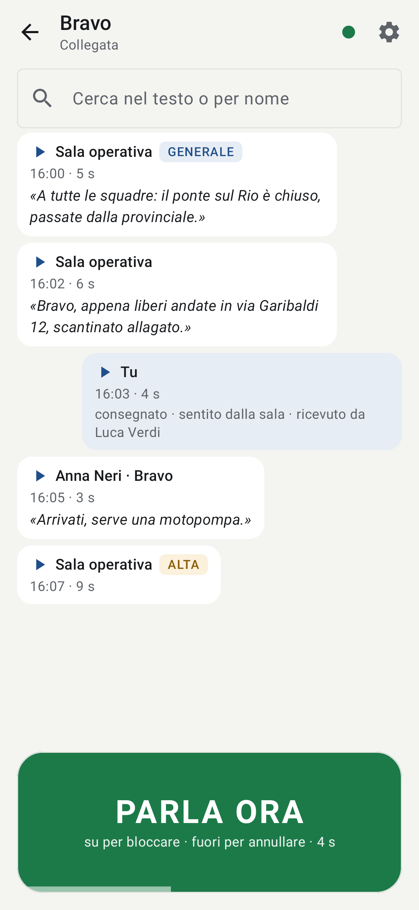

Si tiene premuto PARLA, si aspetta il bip e si parla; lasciando, il messaggio
parte e un doppio bip dice che è arrivato. Se il canale è occupato si sente un
tono basso e il tasto dice chi sta parlando. Trascinando il dito in su il
microfono resta aperto senza tenere premuto (un tocco poi invia); trascinandolo
fuori dal tasto il messaggio si annulla. Un messaggio dura al massimo un
minuto: negli ultimi dieci secondi il tasto conta alla rovescia. Chi preferisce
può scegliere nelle impostazioni **Tocca e ritocca**: il primo tocco apre, il
secondo invia.

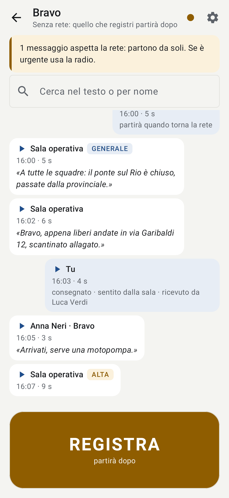

Senza rete il tasto diventa arancione e dice **REGISTRA, partirà dopo**: il
messaggio si registra lo stesso e parte da solo appena torna il campo, con
l'ora in cui è stato detto. Ne restano in attesa al massimo cinque. Se la cosa
è urgente, senza rete si usa la radio.

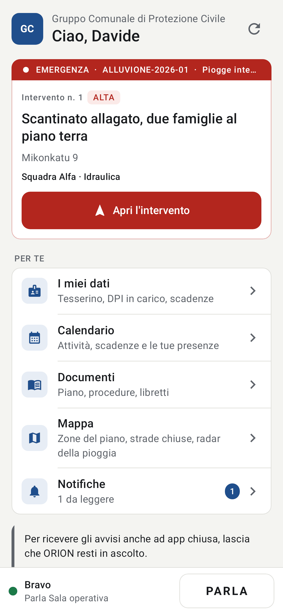

I messaggi arrivano anche a schermo spento e ad app chiusa, finché nelle
notifiche c'è "Orion Voice". Una voce alla volta: se ne arrivano due, la
seconda aspetta la fine della prima, e i messaggi della sala con priorità alta
passano davanti. La voce normale si sente al volume dei contenuti
multimediali, quella urgente al volume della sveglia. Durante una telefonata i
messaggi aspettano e partono alla fine. Quelli arrivati mentre il telefono era
senza rete si ascoltano con **Ascolta** in cima alla schermata.

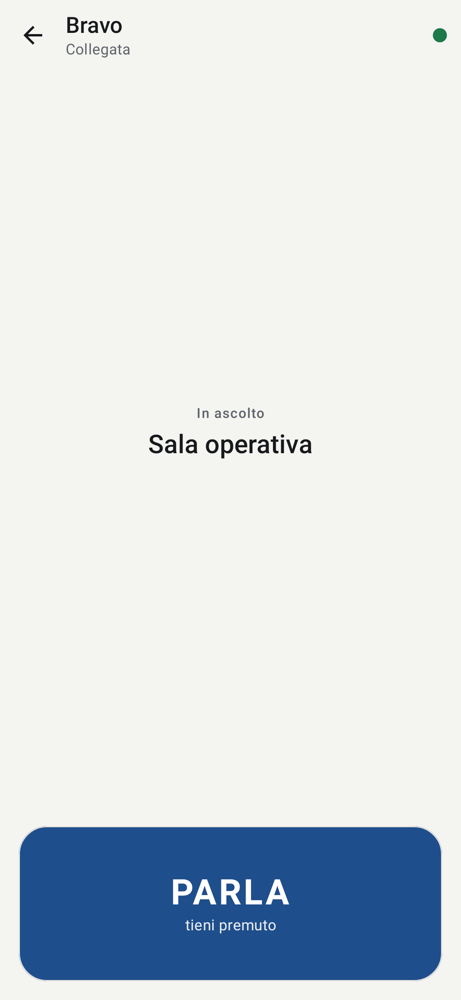

Dalla notifica, **Apri Orion Voice** apre il tasto anche a telefono bloccato, senza
sbloccarlo: si vedono solo il canale e chi parla. Sui telefoni da lavoro con il
tasto laterale per parlare basta quello; il tasto dell'auricolare si accende
nelle impostazioni di Orion Voice (l'ingranaggio), dove si sceglie anche il
microfono dell'auricolare Bluetooth, la **sensibilità del microfono** (se in
sala si sente piano: Alta o Massima) e il volume. La prima volta l'app chiede il
microfono, propone di far suonare i messaggi urgenti anche con "Non
disturbare" e fa fare una **Prova voce**: si parla e ci si riascolta come ci
sentono gli altri. Dopo un riavvio del telefono Orion Voice riparte quando si apre
ORION. Se la stessa persona entra da un altro telefono Orion Voice passa lì, e su
questo compare **Riprendi qui**.

**Il pulsante PTT Bluetooth**, quello che si aggancia al giubbotto, si collega
prima al telefono dalle impostazioni Bluetooth di Android. Poi, nelle
impostazioni di Orion Voice, si tocca **Impara** e si preme il pulsante: da lì
in avanti, tenendolo premuto si parla come con PARLA. Il volume e i tasti del
telefono non si possono scegliere, perché si premono per sbaglio in tasca. Con
l'app aperta funziona subito; per usarlo anche a telefono bloccato o con ORION
chiusa si attiva "Orion Voice, pulsante PTT" fra i servizi di accessibilità di
Android (il tasto per arrivarci è nelle stesse impostazioni): legge soltanto i
tasti e lascia passare tutti quelli che non sono il pulsante.

## 4. La chiamata della sala

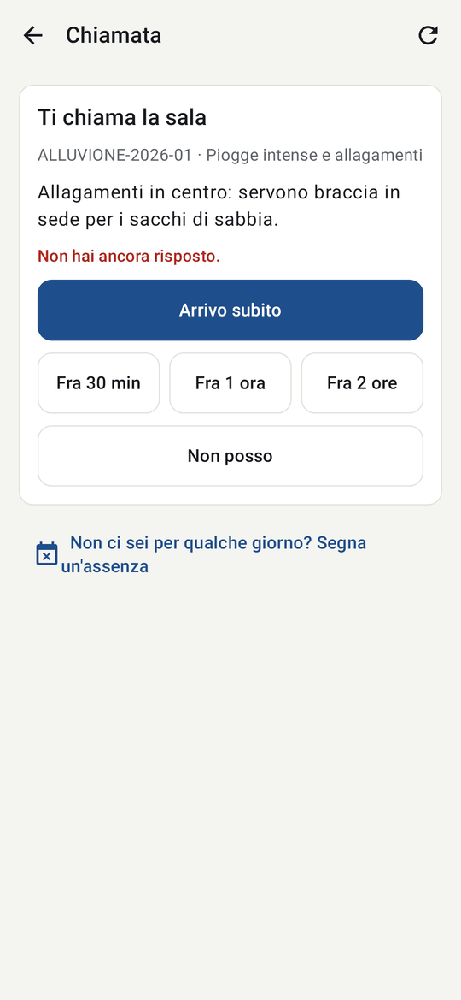

Quando la sala chiama i volontari arriva una notifica d'emergenza che apre
questa schermata, con il messaggio della sala. Si risponde con un tocco:
**Arrivo subito**, **Fra 30 min**, **Fra 1 ora**, **Fra 2 ore** o **Non posso**.

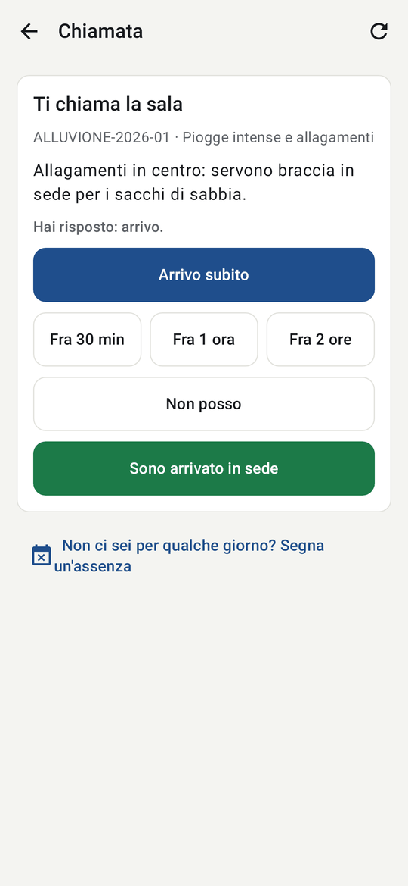

Dopo la risposta, arrivati in sede si tocca **Sono arrivato in sede**. La
risposta si cambia finché non si è arrivati.

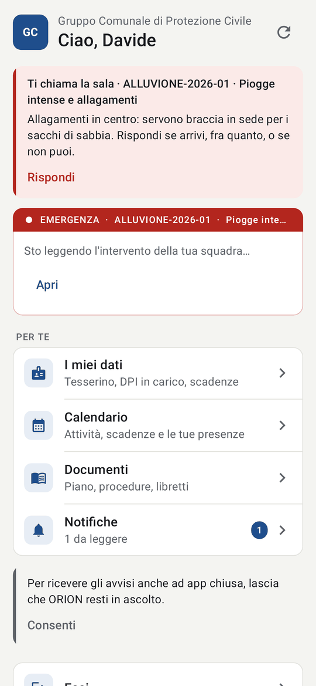

Finché non si risponde, la chiamata resta in cima alla schermata principale.

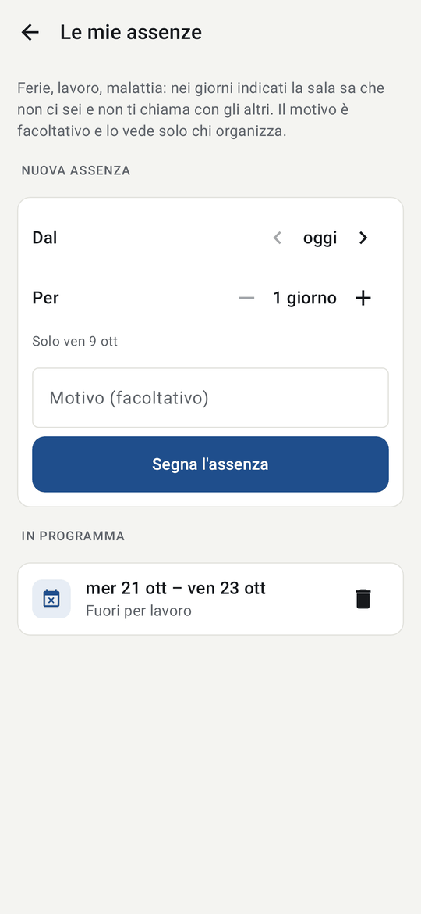

**Le mie assenze** (dalla chiamata o dal calendario) segna i giorni in cui non
ci sei: le frecce spostano il primo giorno, più e meno dicono per quanti
giorni. In quei giorni le chiamate generali non ti arrivano.

## 5. Il calendario

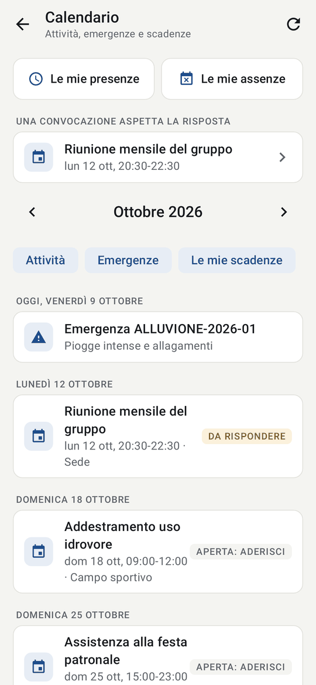

L'agenda giorno per giorno, con le frecce per cambiare mese e i filtri. In cima
le convocazioni che aspettano risposta. **Le mie presenze** e **Le mie assenze**
stanno sotto il titolo.

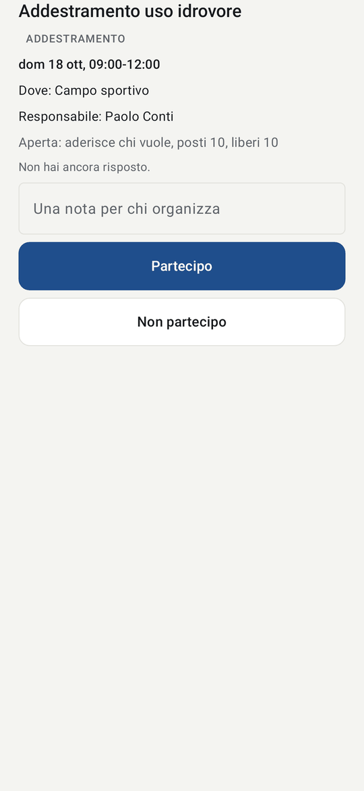

Toccando un'attività si leggono i dettagli e si risponde **Partecipo** o **Non
partecipo**, con una nota facoltativa per chi organizza.

Dopo aver risposto di sì compare **Aggiungi al calendario del telefono**: si
apre l'app del calendario con titolo, orari, luogo e note già scritti, e
l'evento si salva nel calendario che si preferisce. ORION non chiede il
permesso sul calendario e non lo legge: se poi l'attività cambia o viene
annullata, l'evento sul telefono va corretto a mano. Il pulsante resta finché
l'attività non è finita.

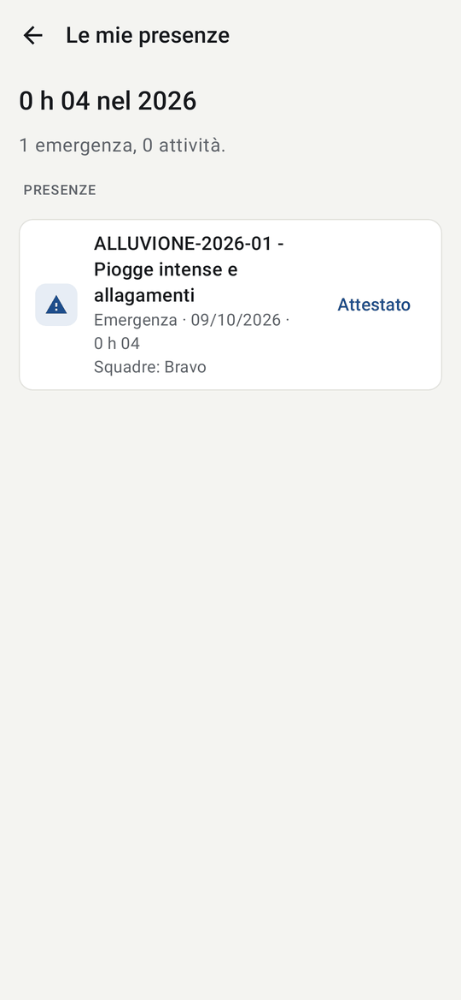

**Le mie presenze** mostra le ore dell'anno, in attività e in emergenza, con
l'**Attestato** in PDF da dare al datore di lavoro.

## 6. I miei dati

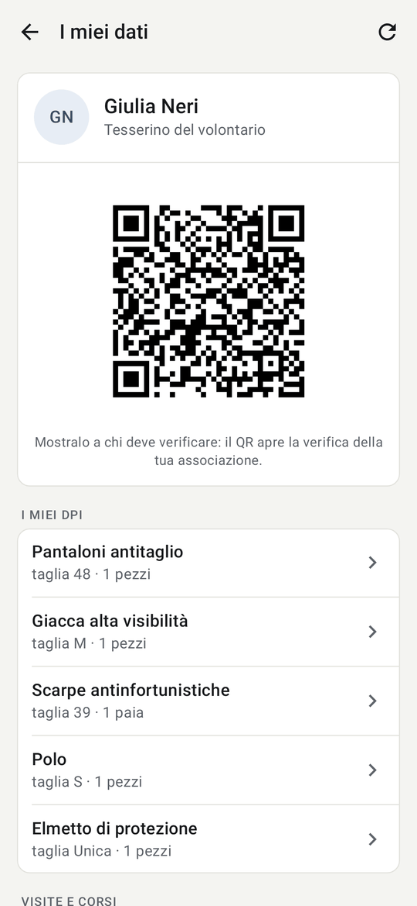

È il fascicolo in tasca. In alto il **tesserino** con il QR, che funziona anche
senza rete. Sotto i **DPI** in carico e, dopo l'impronta o il PIN del telefono,
le **visite** e i **corsi** (sono dati sanitari). Se il magazzino chiede la
conferma di una consegna, qui compare "Da confermare": confermare vale come
firma.

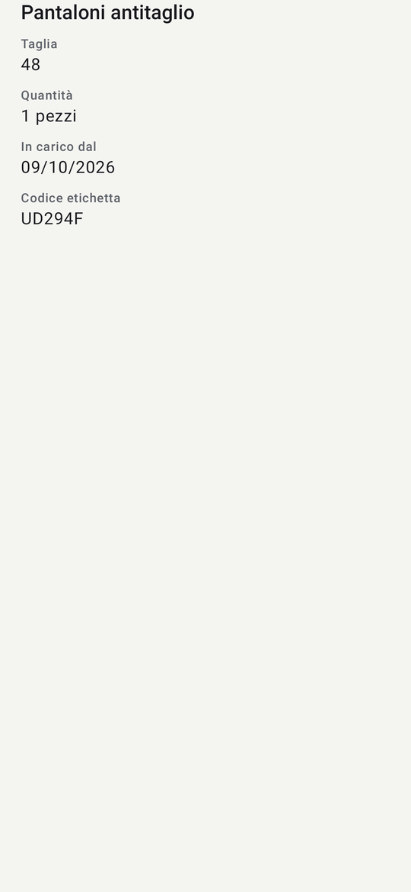

Toccando un DPI se ne vedono taglia, quantità, data di consegna, codice
dell'etichetta e scadenza. Toccando un corso, l'attestato si apre o si salva in
Download.

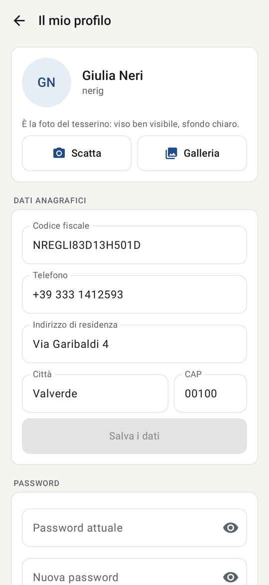

Da I miei dati si apre **Il mio profilo**: la foto del tesserino (scattata o
dalla galleria, da inquadrare nell'ovale), i dati anagrafici, la password, il
fascicolo in PDF e gli avvisi sul telefono. Chi apre le emergenze trova anche
**Avvisami delle novità della sala**: acceso, con un'emergenza aperta arriva
una notifica per una segnalazione ad alta priorità, per una segnalazione
rimasta senza squadra troppo a lungo e per una squadra entrata in una zona
interdetta, anche quando non si è in sala. Cambiando la password gli altri
dispositivi devono rientrare. **Conferma gli accessi** collega questo telefono
alla verifica in due passaggi, o lo scollega, chiedendo la password.

**Entrare dal computer.** Con il telefono collegato, dopo la password il
browser mostra un numero e sul telefono arriva "Stai entrando in ORION?" con
tre numeri: si tocca quello del computer e si conferma con impronta o PIN. Se
non si sta entrando, **Non sono io** blocca l'accesso. Un numero sbagliato lo
blocca lo stesso.

## 7. Notifiche e avvisi

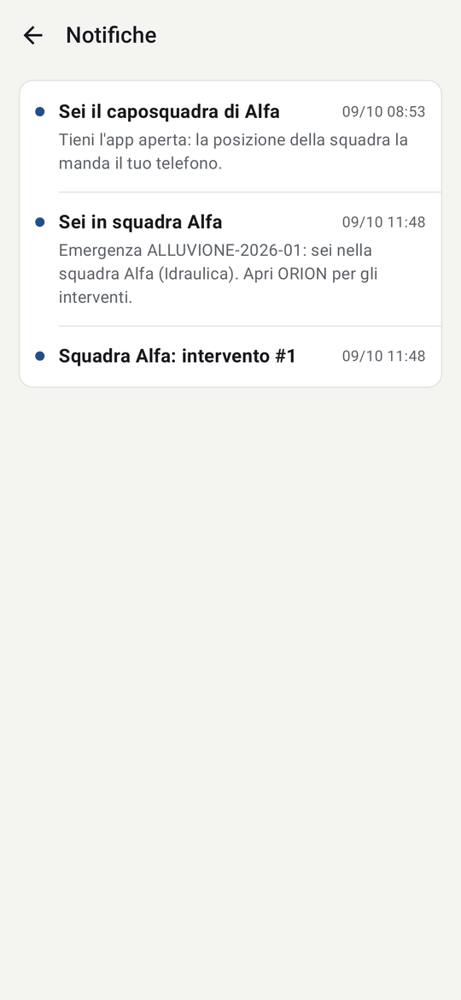

Le notifiche arrivano in quattro gruppi: **Emergenza** (ingresso in squadra,
intervento assegnato, chiamata), **Per te** (DPI da confermare, proprie
scadenze), **Segreteria** e **Magazzino** (i riepiloghi del mattino, per chi ha
quei ruoli). Ogni gruppo è un canale di Android, che si può silenziare senza
perdere gli altri. Toccando una notifica si arriva dove la cosa si guarda.

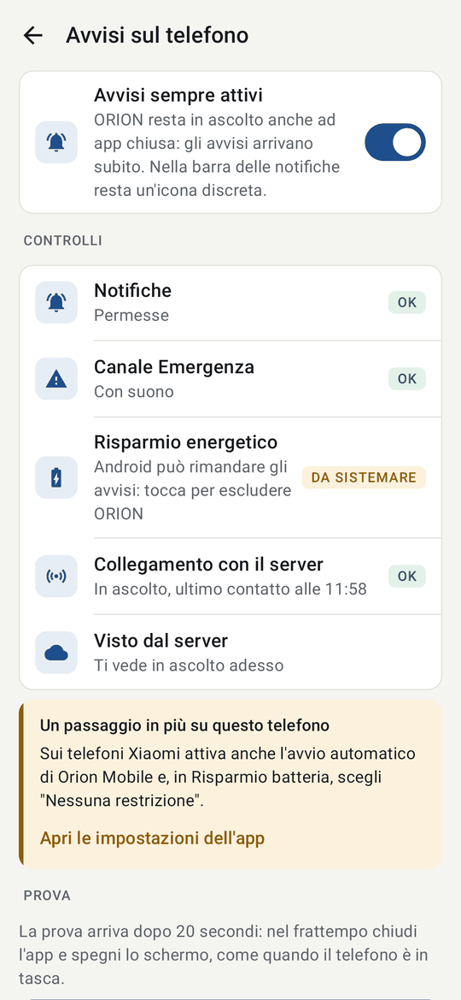

Perché gli avvisi arrivino anche ad app chiusa, l'app resta in ascolto del
server (un'icona discreta fra le notifiche). Se l'associazione usa Firebase,
l'icona non c'è: il telefono viene svegliato a ogni avviso e la schermata
dice "Avvisi con Firebase". Non c'è niente da fare: l'app passa da sola a
Firebase e torna indietro se l'associazione lo spegne. La schermata **Avvisi sul
telefono** controlla tutto quello che serve: permesso delle notifiche, canale
Emergenza non silenziato, risparmio energetico, collegamento con il server.
Ogni voce da sistemare si tocca e porta dove si sistema. **Manda una prova** fa
arrivare una notifica dopo venti secondi: conviene farla appena installata
l'app, con lo schermo spento.

## 8. I documenti

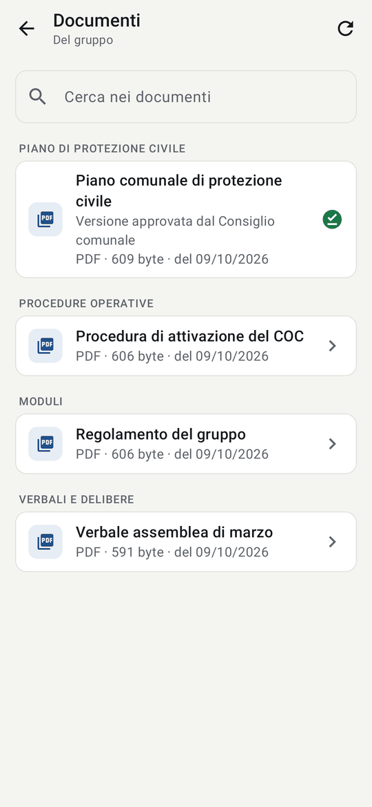

Le stesse cartelle del web. Il segno verde accanto a un documento dice che è
sul telefono e si apre anche senza rete: sono i documenti "sempre con me" e i
libretti del materiale che si ha in carico.

## 9. La mappa

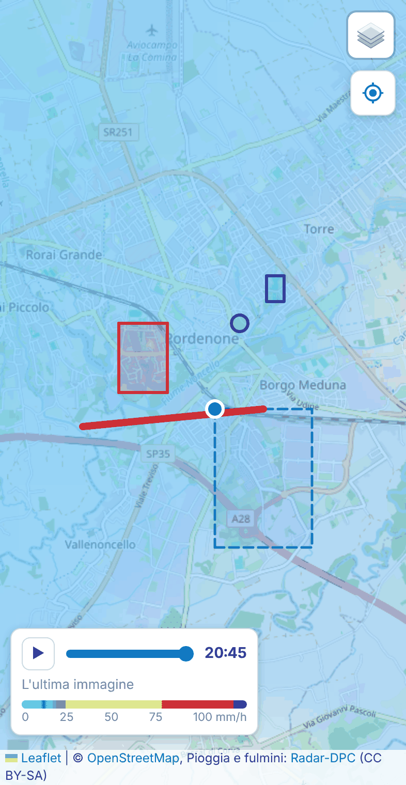

**Mappa**, dalla schermata principale, mostra il territorio con quello che la
sala ha disegnato: strade chiuse e zone interdette, zone di pericolo, aree del
piano (attesa, accoglienza, ammassamento). Le segnalazioni e le squadre non ci
sono: per l'intervento della propria squadra c'è la sua schermata. Toccando
una zona o una strada si leggono nome, livello e note. Il punto blu è il
telefono, se ha il permesso della posizione; il pulsante col mirino ci porta
la mappa. Dalla schermata dell'intervento, "Vedile tutte sulla mappa" apre la
stessa mappa.

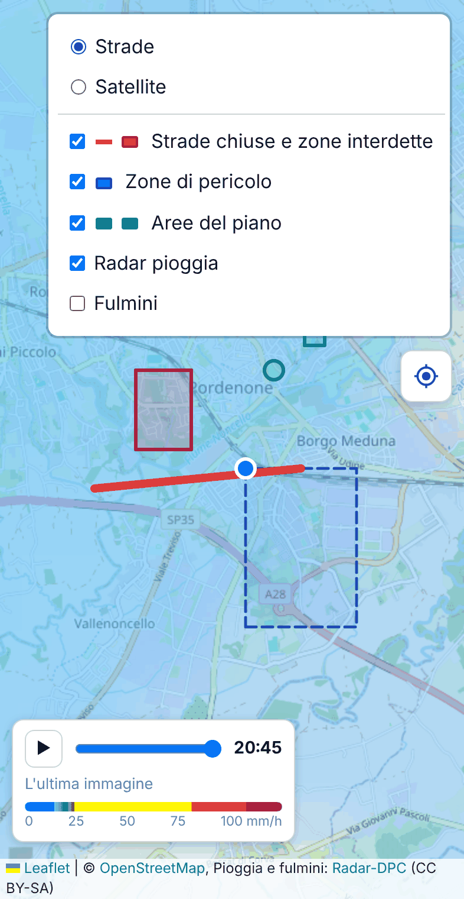

Il pulsante in alto a destra sceglie il fondo (strade o satellite, e la
cartografia del territorio se l'associazione l'ha caricata sul server) e cosa
mostrare: i tre gruppi di zone, il radar della pioggia e i fulmini, come nella
mappa della sala. Il radar ha in basso l'ora dell'immagine e ▶ per far
scorrere l'ultima ora. Quando la sala cambia qualcosa la mappa si aggiorna da
sola. Senza rete si apre lo stesso, con le zone dell'ultima volta e le
tessere già viste; il radar e il satellite servono la rete.

## 10. Il magazzino

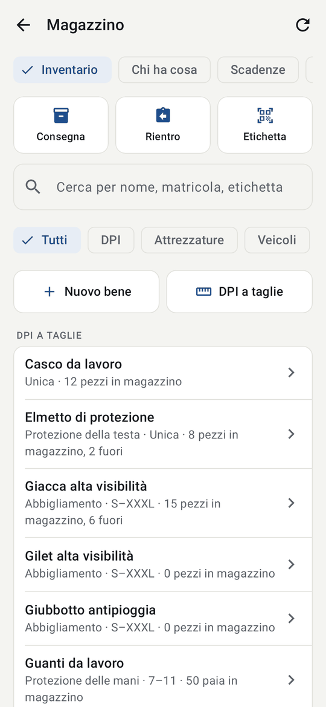

Chi gestisce il magazzino lo lavora tutto dall'app: le schede **Inventario**,
**Chi ha cosa**, **Scadenze**, il registro e le impostazioni. In cima
all'inventario ci sono **Consegna**, **Rientro** ed **Etichetta** (inquadra un
QR e apre il bene). Si cerca per nome, matricola o etichetta e si filtra per
tipo. **Nuovo bene** e **DPI a taglie** creano un bene o un DPI con le sue
taglie.

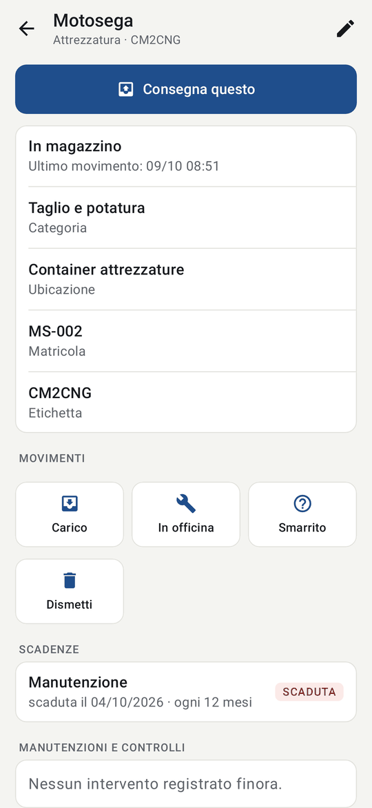

La scheda di un bene dice dove si trova, cosa scade e la sua storia. **Consegna
questo** apre la consegna con l'oggetto già scelto. Sotto ci sono i movimenti:
**Carico**, **In officina**, **Smarrito**, **Dismetti**. La matita in alto lo
modifica.

### Consegnare

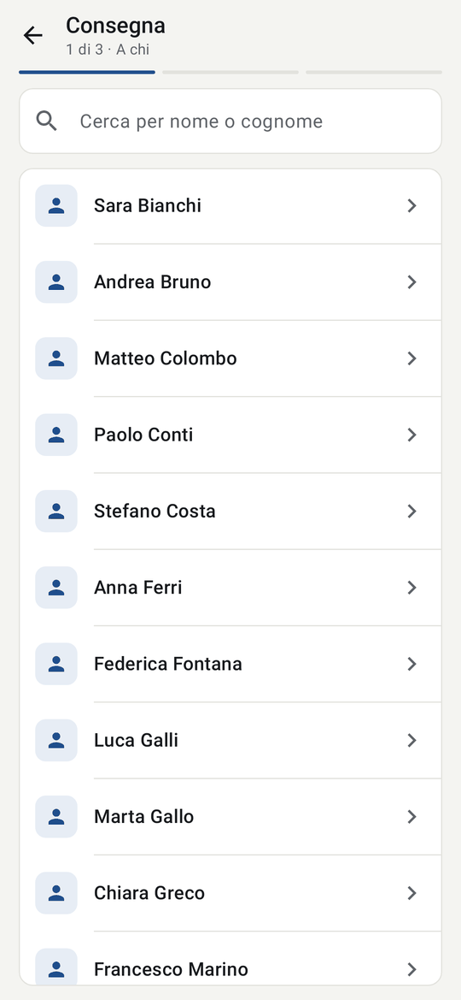

Tre passi. **A chi**: si cerca la persona.

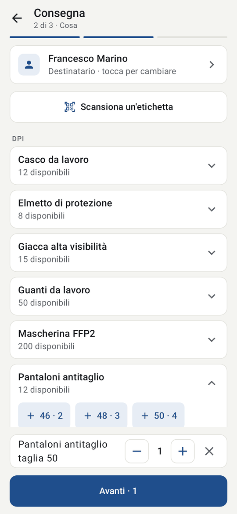

**Cosa**: si aprono i DPI e si tocca la taglia, oppure **Scansiona
un'etichetta**. La taglia della persona è segnata in verde. In fondo, **Avanti**
porta al riepilogo e alla conferma.

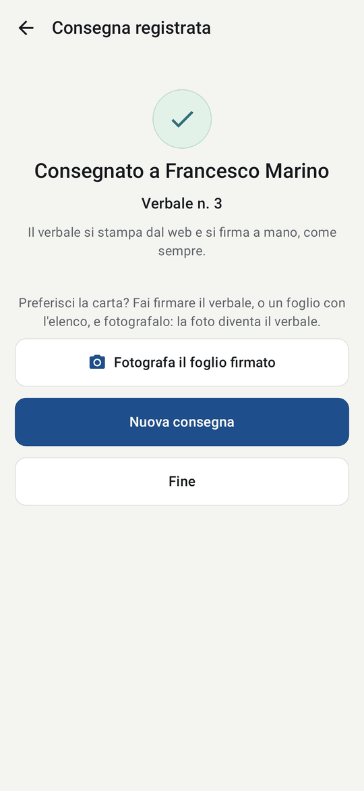

Fatta la consegna, se c'è il verbale si può fotografare il foglio firmato: la
foto diventa il verbale. La consegna funziona anche senza rete: resta in coda e
parte appena c'è campo.

### Il rientro

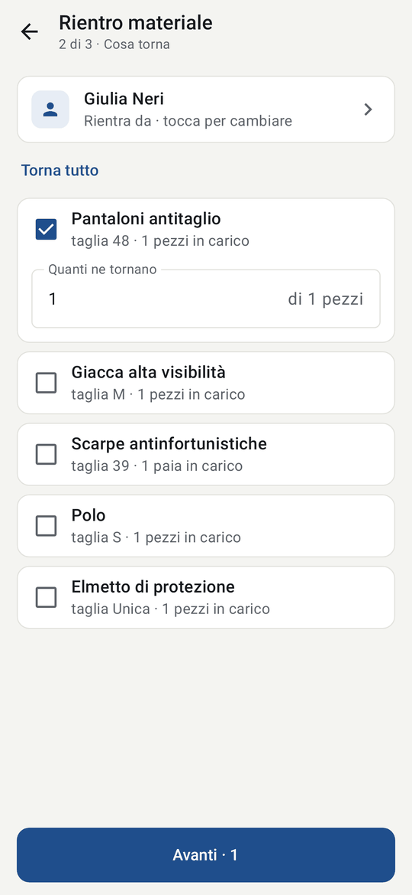

Si sceglie chi restituisce, si spunta cosa torna e quanto; se torna meno,
l'app chiede cosa ne è del resto. Il rientro vuole la rete.

### Le impostazioni del magazzino

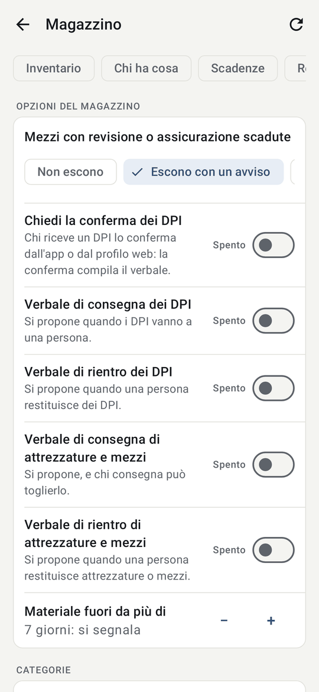

Ogni scelta si salva appena la si tocca: mezzi scaduti, conferma dei DPI,
verbali, giorni prima di segnalare il materiale fuori, categorie, ubicazioni e
i propri avvisi via email. La stampa delle etichette resta sul web.

## 11. Iscrivere un volontario

Chi gestisce l'anagrafica trova nella schermata principale **Iscrivi un
volontario**: nome, cognome ed email facoltativa. L'app mostra un QR da far
inquadrare con la fotocamera del telefono della persona, che si attiva da sola
come nel primo accesso. Il link vale sette giorni; se c'è l'email parte anche
lì. I ruoli diversi da volontario si danno dal web.

## 12. La segreteria

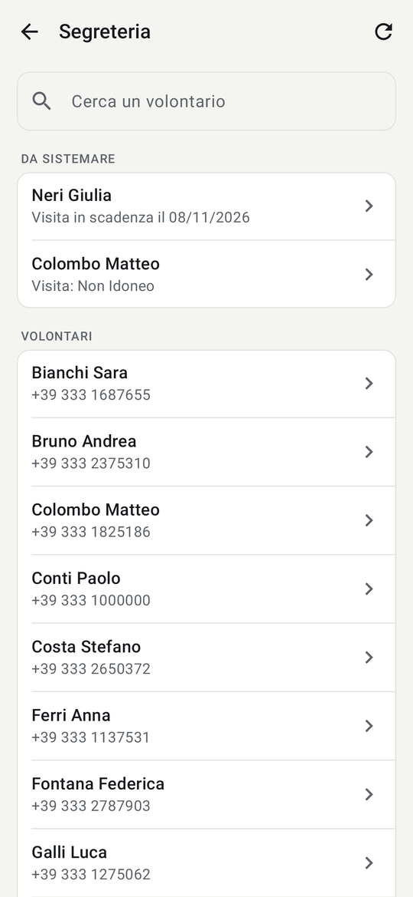

Si apre con l'impronta o il PIN. In cima chi ha qualcosa da sistemare, sotto
l'elenco dei volontari da cercare per nome. Il fascicolo mostra contatti (si
chiama con un tocco), visite, corsi e DPI.

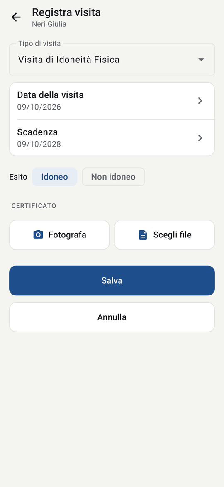

Si registra una visita o un corso: tipo, data, scadenza (proposta dal
catalogo), esito, e il certificato fotografato o scelto dai file. Anagrafica,
cataloghi e tesserini restano sul web. Senza rete la segreteria non si apre:
sono dati sanitari e sul telefono non si tengono.

## 13. Gli aggiornamenti

Quando l'associazione mette sul server una versione nuova, l'app se ne
accorge la prima volta che la si apre (o, se resta chiusa, entro un giorno),
la scarica da sola e la installa quando non la si sta usando; con
un'emergenza aperta e si è in squadra, aspetta. Nella schermata principale un
riquadro dice a che punto è, e "Aggiorna ora" la installa subito. La prima
volta Android chiede di consentire l'installazione da ORION (pulsante
"Consenti", poi "Consenti da questa fonte") e di confermare; da Android 12 in
poi le volte successive non chiede più niente. Dati e accesso restano. L'app
installa solo un file firmato con la stessa chiave e più recente.

## 14. Quando qualcosa non va

| Cosa succede | Cosa fare |
|---|---|
| "Sessione scaduta" | Si rientra; se non va, la password è cambiata o l'account è sospeso |
| "Troppi tentativi sbagliati per questo account" | Aspettare il tempo indicato e riprovare |
| La password nuova viene rifiutata | Il messaggio dice perché: meglio una frase o più parole che non stanno insieme |
| Il codice a sei cifre viene rifiutato | L'ora del telefono deve essere automatica |
| La richiesta d'accesso non compare sul telefono | Aprire l'app: compare da sola; altrimenti "Usa un codice" nel browser |
| Telefono collegato perso o cambiato | Un codice di riserva, poi si collega il nuovo; senza codici l'amministratore azzera la verifica |
| Le notifiche non arrivano ad app chiusa | Avvisi sul telefono: sistemare le voci segnalate e fare la prova |
| La sala non vede la squadra | Posizione "Consenti sempre" e persona in squadra |
| Una consegna non compare sul web | È in coda: parte appena c'è campo |
| L'accesso esterno è finito | L'emergenza è chiusa o l'accesso è stato revocato |
