# ORION dal browser

Questo è il manuale della web app di ORION, quella che si apre dal browser del
computer della sede o della sala operativa. Per il telefono c'è il
[manuale dell'app Android](manuale-app.md).

Le immagini vengono da un gruppo di prova, il "Gruppo Comunale di Protezione
Civile", con persone e dati inventati e la cartografia di OpenStreetMap.

Ognuno vede solo le voci che gli servono. Il menu e i pulsanti cambiano in
base al ruolo (volontario, coordinatore, segreteria, magazziniere,
amministratore) e ai moduli accesi dall'amministratore. Se una voce descritta
qui non c'è, non è un errore: non è per il tuo ruolo, o il modulo è spento.

## 1. Entrare

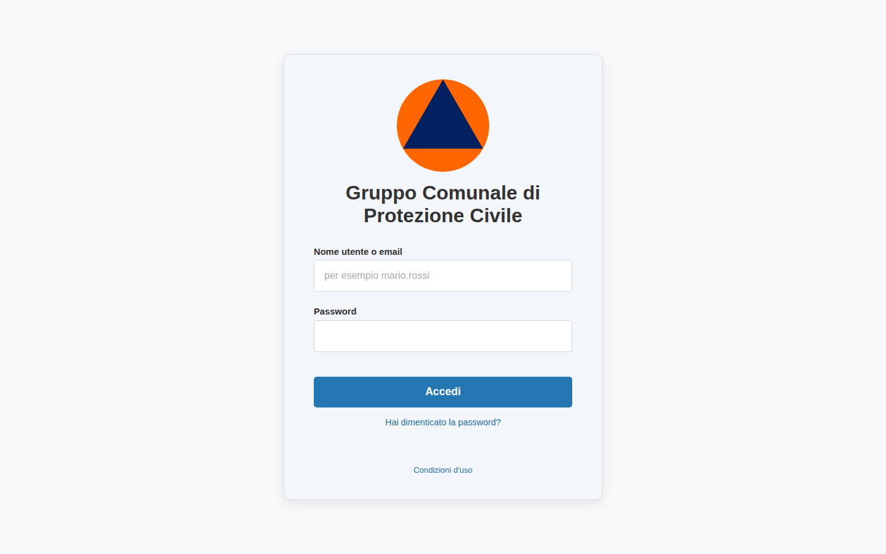

Si entra con il nome utente (o l'email) e la password. La prima password la
sceglie ciascuno dal link di attivazione che riceve quando viene iscritto: vale
sette giorni e arriva per email oppure su un foglio stampato con un QR.

La password deve avere almeno 12 caratteri, con maiuscole, minuscole, un
numero e un simbolo, e non deve essere una parola comune travestita
("P@ssw0rd2025!", il nome di una squadra di calcio con l'anno) né contenere
il proprio nome, cognome o nome utente. Se ORION la rifiuta, il messaggio
dice perché; la via più semplice è una frase o tre o quattro parole che non
stanno insieme, con un numero e un simbolo.

Dopo cinque password sbagliate di fila sullo stesso account (con il nome
utente o con l'email, contano insieme) l'account si
ferma per un minuto, e la pausa raddoppia a ogni errore successivo fino a un
quarto d'ora: il messaggio dice quanto aspettare, e la password giusta, dopo
la pausa, azzera il conto. Dopo troppi tentativi sbagliati dalla stessa rete
l'accesso si blocca per un quarto d'ora; gli accessi riusciti non contano,
così una sala che entra tutta insieme non si blocca.

Chi ha dimenticato la password usa "Hai dimenticato la password?" (serve la
posta configurata) oppure chiede all'amministratore un link nuovo. Chi non ha
ancora attivato l'account usa il link ricevuto all'iscrizione, finché vale, o ne
chiede uno nuovo a chi l'ha iscritto: "Hai dimenticato la password?" non lo
sostituisce, perché quel link può essere stampato sul foglio con il QR. Il browser
ricorda il nome dell'ultima persona entrata; su un computer usato da tanti,
"Non sei tu?" lo cancella.

**Verifica in due passaggi.** Oltre alla password ORION chiede una conferma
dal telefono. Con l'app ORION collegata, la pagina mostra un numero e sul
telefono arriva la richiesta: si tocca lo stesso numero e si conferma con
impronta o PIN, e la pagina entra da sola. Senza l'app (per esempio con un
iPhone) si usa un codice di sei cifre preso da un'app per i codici a tempo
(Google Authenticator, Microsoft Authenticator, Aegis, FreeOTP); "Usa un
codice" passa dall'una all'altra. È obbligatoria per gli amministratori e per
chi gestisce visite mediche e corsi; per gli altri si attiva dall'app o dal
profilo. All'attivazione si ricevono dieci codici di riserva, da conservare
lontano dal telefono: ognuno vale una volta, al posto della conferma.

Il link d'attivazione aperto su un telefono Android propone **Continua
nell'app**: password, condizioni d'uso e telefono collegato si fanno lì, senza
passare dal computer.

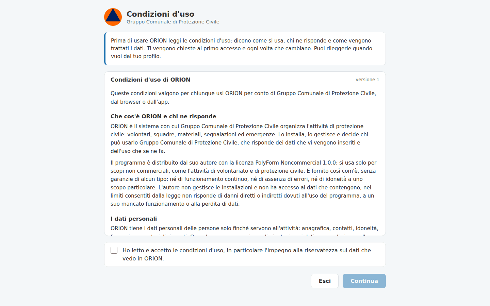

**Condizioni d'uso.** Al primo accesso, e ogni volta che l'amministratore le
cambia, ORION chiede di leggerle e accettarle. Senza, non si entra.

**Dove si arriva.** Con un'emergenza aperta si arriva tutti al centro
operativo. Senza emergenza l'amministratore va al centro operativo, la
segreteria alla Segreteria, il magazziniere al Magazzino, tutti gli altri al
proprio profilo.

## 2. Il menu

Il menu sta a sinistra in ogni pagina (sul telefono, dietro il pulsante
"Menu"). In fondo alcune pagine aggiungono voci loro: la Segreteria i
cataloghi, il profilo le sue sezioni.

| Voce | A cosa serve | Chi la vede |
|---|---|---|
| Centro Operativo | La sala operativa: mappa, segnalazioni, squadre | Tutti |
| Segreteria | Fascicoli dei volontari: visite, corsi, tesserino | Segreteria e amministratore, a modulo acceso |
| Magazzino | DPI, attrezzature e mezzi: consegne, rientri, scadenze | Interni, a modulo acceso |
| Squadre | Le squadre e i loro membri | Interni |
| Calendario | Attività, convocazioni, presenze, reperibilità | Interni, a modulo acceso |
| Simulazioni | Scenari per addestramenti ed esercitazioni | Chi organizza le attività |
| Documenti | Piano, procedure, libretti, verbali | Tutti |
| Utenti | Iscrizioni, ruoli, permessi, password | Amministratore e chi gestisce l'anagrafica |
| Archivio emergenze | Emergenze chiuse e resoconti | Chi consulta l'archivio |
| Funzioni | Le funzioni di supporto del COC | Coordinatore e amministratore, a modulo acceso |
| Impostazioni | Moduli, nome e logo, posta, tesserino, mappa | Amministratore |
| Sistema | Backup, aggiornamenti, cifratura, integrità | Amministratore |
| Il mio profilo | I propri dati, il fascicolo, la sicurezza | Tutti |
| Esci | Chiude la sessione | Tutti |

## 3. Il mio profilo

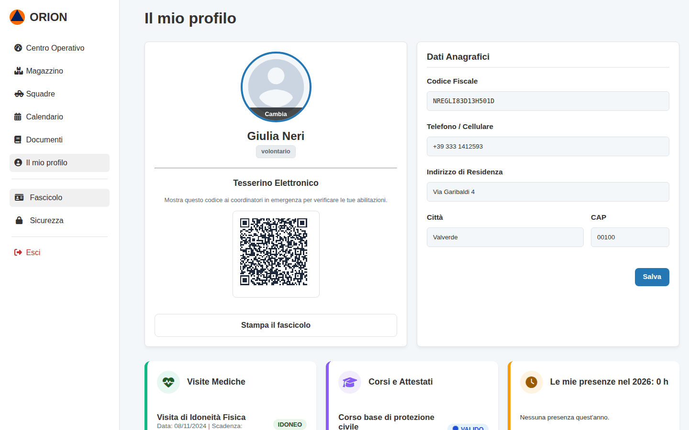

È il fascicolo personale. In alto ci sono la foto, il nome, il tesserino
elettronico con il QR e "Stampa il fascicolo", che prepara il PDF con dati,
visite e corsi. A destra si correggono codice fiscale, telefono e indirizzo.
Sotto ci sono le visite mediche, i corsi con gli attestati, le presenze
dell'anno con gli attestati da scaricare e i DPI in dotazione.

Se il magazzino chiede la conferma dei DPI, in cima compare "Materiale da
confermare": confermare vale come firma del verbale. La foto si cambia toccando
"Cambia": si inquadra il viso nell'ovale e si salva. Dalla voce **Sicurezza** del
menu si cambia la password e si gestisce la verifica in due passaggi: l'elenco
dei telefoni collegati (ognuno si scollega con la password), l'app dei codici,
i codici di riserva. Un telefono nuovo si collega dall'app.

Chi apre le emergenze (coordinatore e amministratore) trova nel profilo
**Avvisami delle novità della sala**, acceso di serie. Con un'emergenza
aperta arriva allora una notifica nell'app anche a chi non è in sala: quando
si crea una segnalazione ad alta priorità, quando una segnalazione resta
senza squadra oltre i minuti critici delle Impostazioni, quando una squadra
entra in una zona interdetta. Ogni fatto arriva una volta sola.

## 4. Il centro operativo

### Senza emergenza

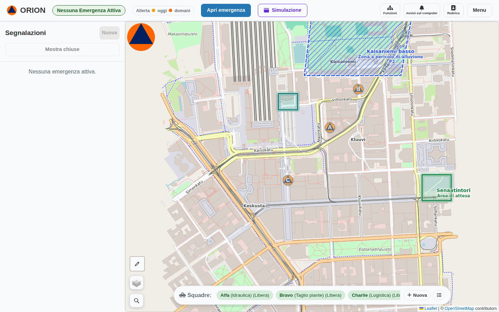

A sinistra l'elenco delle segnalazioni, al centro la mappa, in basso la barra
delle squadre. I pulsanti in alto:

| Pulsante | Cosa fa |
|---|---|
| Allerta | Il bollettino di allerta della zona del Comune, se acceso nelle impostazioni |
| Apri emergenza | Apre un'emergenza (chi ha il permesso) |
| Simulazione | Apre la sala per un addestramento al volo (capitolo 9) |
| Funzioni | Il tavolo delle funzioni di supporto |
| Avvisi sul computer | Chiede al browser di mostrare gli avvisi anche a finestra chiusa |
| Rubrica | I numeri utili dell'emergenza |
| Menu | Le altre pagine (archivio, segreteria, magazzino, calendario, documenti, squadre, profilo, uscita) |

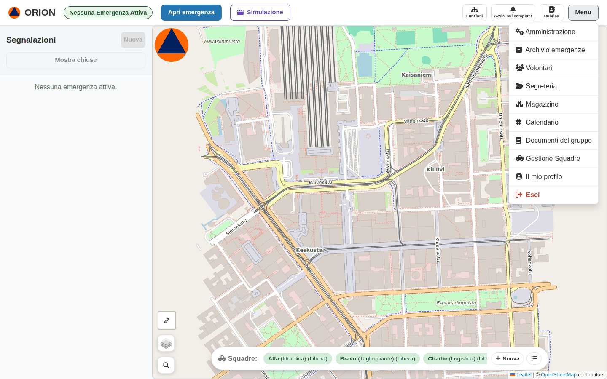

Il menu scorre da sinistra e porta, oltre alle altre pagine, le voci della
sala; Esc lo chiude. Finché non c'è un'emergenza aperta l'amministratore
trova in alto i **Primi passi**: le cose da fare una volta sola (nome e logo
dell'associazione, centro della mappa, posta, un'altra persona iscritta, la
chiave di recupero della cifratura messa da parte), ognuna con il collegamento
alla sua pagina. Spariscono da soli quando sono fatti, oppure con "Nascondi".

**Lo schermo a parete** (dal menu) è la pagina da lasciare sul televisore
della sala: la mappa con le segnalazioni aperte, i conteggi, le squadre con il
loro impegno e l'ora. Non si tocca: si aggiorna da sola a ogni novità, e
senza emergenza dice che non ce n'è.

### Il bollettino di allerta

Accanto allo stato dell'emergenza c'è la pastiglia **Allerta**, con un pallino
per oggi e uno per domani: verde nessuna allerta, poi giallo, arancione, rosso.
Il grigio vuol dire che il bollettino di oggi non è ancora arrivato (esce di
norma entro le 16) o che la Regione non ha trasmesso la valutazione.

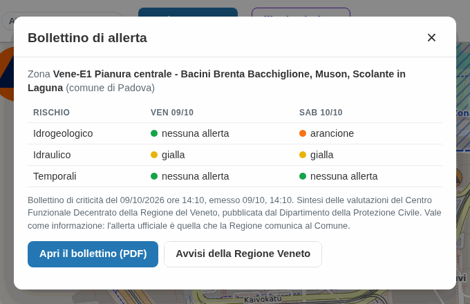

Un clic apre la finestra: la zona d'allerta, il livello di ciascun rischio
(idrogeologico, idraulico, temporali) per i due giorni, il PDF del bollettino e
il collegamento agli avvisi della Regione. Se nella giornata esce un
aggiornamento, ORION lo legge da solo e la finestra elenca tutte le versioni.

Il bollettino è quello nazionale del Dipartimento della Protezione Civile, che
riporta le valutazioni del Centro Funzionale della Regione. Vale come
informazione: l'allerta ufficiale resta quella che la Regione manda al Comune
per i canali previsti dal piano.

Con un'emergenza aperta ogni versione del bollettino, compresa quella in
vigore al momento dell'apertura, entra da sola nei **documenti
dell'emergenza** (il PDF, caricato da "ORION") e nel **diario di sala** (i
livelli della zona). Così finisce nel resoconto e nello storico sigillato. Le
simulazioni non lo ricevono.

### Aprire un'emergenza

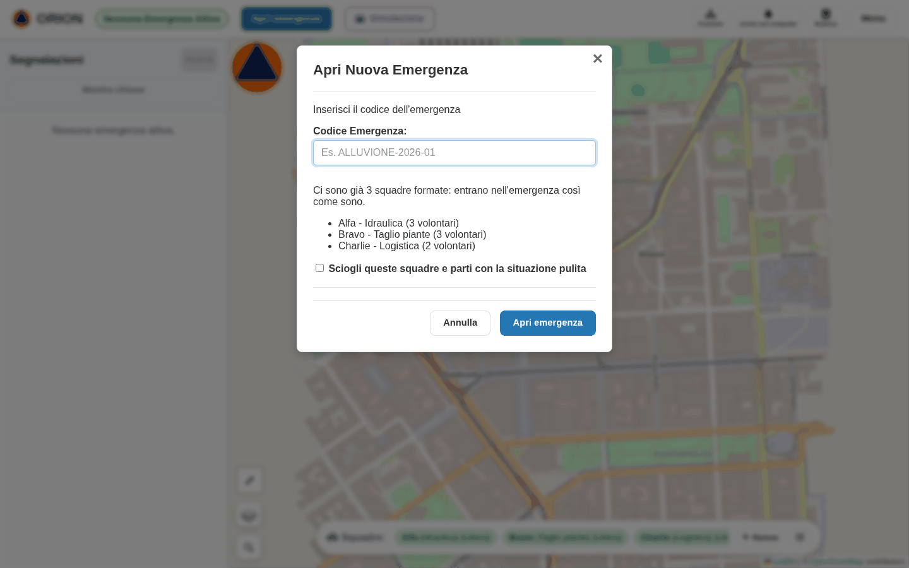

Si scrive il codice dell'emergenza. Le squadre già formate entrano così come
sono; la casella "Sciogli queste squadre" le chiude e si parte da zero. Chi è in
una squadra riceve l'avviso sull'app. All'apertura ORION crea anche la squadra
**COC**, cioè chi lavora in sala: si compone come le altre, non va sugli
interventi e vede tutte le segnalazioni.

### La sala durante l'emergenza

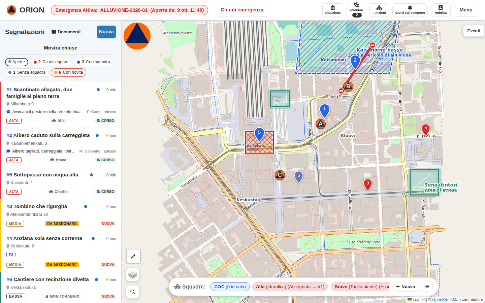

In alto c'è la fascia rossa con il codice dell'emergenza, accanto "Chiudi
emergenza". I pulsanti diventano Situazione, Volontari, Funzioni, Avvisi sul
computer, Rubrica e Menu.

**L'elenco delle segnalazioni.** Ogni scheda mostra numero, titolo, indirizzo,
l'ultima nota scritta da una persona, la priorità, la squadra e lo stato. In
cima c'è il riepilogo: Aperte, Da assegnare, Con squadra, Senza squadra, Con
novità. Un clic su una voce filtra l'elenco, un altro lo riporta completo.
"Documenti" apre i documenti caricati per questa emergenza.

**I colori.** Il segnaposto è rosso se aspetta una squadra, blu se ne ha una,
viola se non ne ha bisogno (gestita da altro ente, solo monitoraggio, nessun
intervento), verde se risolta, grigio se chiusa. Quelle ad alta priorità hanno
il segnaposto più grande. Una segnalazione senza squadra da più di 15 minuti
(il tempo si cambia nelle Impostazioni) diventa rossa con la scritta DA
ASSEGNARE.

**Le novità.** Una nota dal campo, delle foto o una segnalazione nuova fanno
lampeggiare la scheda e saltare il segnaposto, e compare un avviso in alto a
destra. Le modifiche dei colleghi in sala aggiungono solo un numero alla scheda.
Il server ricorda cosa ha letto ciascuno, anche cambiando computer.

**Eventi.** La linguetta "Eventi" a destra apre il diario di sala: si scrive
quello che non riguarda una segnalazione (la telefonata con il Sindaco, una
decisione presa) e si preme Annota o Ctrl+Invio. Il diario finisce nel resoconto.

### Le segnalazioni

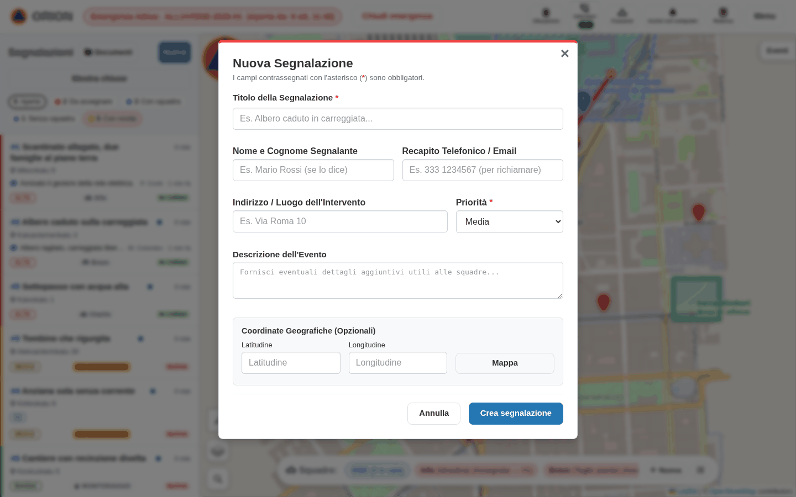

"Nuova" apre il modulo. Serve solo il titolo, cioè cosa succede: nome e numero
di chi chiama, indirizzo, priorità e descrizione si aggiungono quando ci sono.
Il **tipo** (allagamento, albero o ramo, frana, persona da soccorrere o
assistere, viabilità, edificio o struttura, altro) si sceglie con un tocco sui
pulsanti a icona; se non si sceglie vale "altro". Scrivendo l'indirizzo
compaiono i suggerimenti, e sceglierne uno mette anche il punto. Il punto si
mette altrimenti con "Mappa" e un clic (una fascia in alto spiega cosa fare,
Esc torna al modulo senza perdere quello che si è scritto), oppure scrivendo
le coordinate.

Se c'è già una segnalazione aperta entro cento metri dal punto, prima di
crearla il modulo la mostra con numero, titolo e da quanto è aperta: "Apri
quella" porta alla sua scheda (quello che si stava scrivendo resta come nota
da aggiungere), "Crea comunque" va avanti. Serve per le due telefonate sullo
stesso albero.

Nell'elenco il tipo è un'icona accanto al titolo, e in cima un filtro per tipo
si aggiunge agli altri. Il punto di situazione e il resoconto contano le
segnalazioni per tipo. Sullo schermo largo del portatile la scheda di una
segnalazione si apre al posto dell'elenco, con "Torna all'elenco"; su uno
schermo più grande si apre accanto.

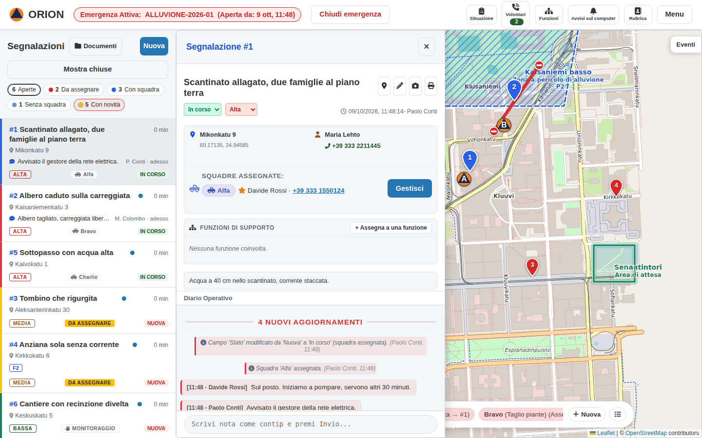

Cliccando una segnalazione si apre la sua scheda. In alto si cambiano stato e
priorità; le icone servono a modificare, spostare il punto, caricare foto e
stampare. Poi vengono le squadre assegnate (con il caposquadra e il suo
telefono), le funzioni di supporto e il diario. "Gestisci" assegna o toglie le
squadre, oppure dice perché la segnalazione non ha bisogno di una squadra. Il
diario tiene in ordine tutto quello che succede: le note delle persone e,
più chiari, gli eventi registrati da ORION. Si scrive in fondo e si preme Invio.

Assegnare la prima squadra porta la segnalazione a "In corso"; togliere
l'ultima la riporta ad "Aperta". Se il punto cade in una zona di pericolo
disegnata sulla mappa, ORION lo aggiunge ai rischi da solo.

**Lo stato di ogni squadra.** Fra le squadre assegnate ognuna dice a che punto
è: assegnata, partita, sul posto, intervento concluso, rientrata. Lo cambia la
squadra dall'app (o dal web, chi ne fa parte); la sala lo può correggere con
la tendina accanto al nome, anche all'indietro. Ogni cambio scrive nel diario
una nota come "Alfa sul posto, 14:32" e il resoconto riporta per ogni squadra
quanto ci ha messo ad arrivare e quanto è rimasta sul posto. "Intervento
concluso" non chiude la segnalazione: lo decide la sala.

### Le squadre in sala

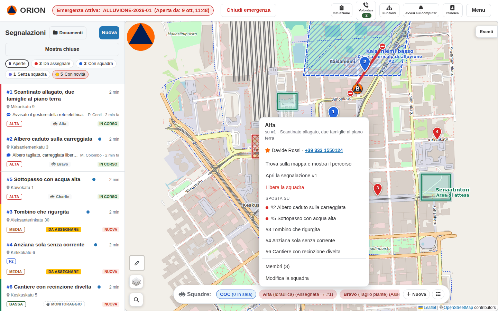

Nella barra in basso ogni squadra dice dov'è impegnata. Un clic apre il suo
menu: il caposquadra con il telefono, "Trova sulla mappa e mostra il percorso",
la segnalazione su cui lavora, "Libera la squadra", lo spostamento su un'altra
segnalazione, i membri e la modifica. Nella finestra dei membri la stella
nomina il caposquadra. "Nuova" crea una squadra. Sulla mappa ogni squadra con
l'app accesa compare con la sua lettera. La barra mette prima la squadra COC,
poi le squadre impegnate con il loro stato (partita, sul posto...), poi le
libere; con tante squadre le frecce ai lati la fanno scorrere.

Chi è in una squadra e apre il centro operativo trova in alto **La tua
squadra**, con l'intervento assegnato e "Apri"; nell'elenco la sua
segnalazione è segnata.

### Il drone

Se il drone è acceso nelle Impostazioni e MediaMTX è installato sul server
(vedi il manuale tecnico), durante un'emergenza o una simulazione nella fascia
in alto c'è **Drone**, con un pallino rosso quando un drone è in onda. Il
pannello mostra la diretta, i droni collegati e il loro stato (in onda,
spento, tolto).

**Collegare il drone.** Chi apre le emergenze scrive il nome del drone o del
pilota ("Matrice 4E – Marco") e tocca "Dai una chiave al pilota". ORION
mostra l'indirizzo e un QR: il pilota, in DJI Pilot 2, sceglie Diretta (Live
Stream), RTMP personalizzato, e incolla l'indirizzo o lo inquadra. La chiave
si vede solo in quel momento, vale per l'emergenza in corso e smette di valere
alla chiusura. "Togli" la annulla subito e ferma la diretta. Il video del
drone va impostato in H.264.

**Guardare.** Quando un drone va in onda il pannello lo mostra da solo. Con
più droni, "Guarda" aggiunge una diretta accanto alle altre: il pannello si
allarga e le mette in griglia. Il pulsante con la freccia apre una diretta in
una finestra a parte, che si sposta tenendo premuta la testata e si
ridimensiona dall'angolo in basso a destra; le finestre restano aperte anche
chiudendo il pannello, così si lavora sulla mappa con il video sopra. Nella
testata di ogni diretta ci sono i comandi per staccarla o rimetterla nel
pannello, per tenerla sopra tutte le finestre anche fuori dal browser
(picture-in-picture, dove il browser lo permette), per lo schermo intero e
per smettere di guardarla. Quando un drone smette di trasmettere la sua
diretta si chiude da sola. Ogni diretta guardata è un video in più sulla rete
della sala, circa 3 Mbit/s l'una. Lo schermo a parete apre la diretta in un
riquadro in basso a destra. Gli esterni non vedono le riprese.

**Quanti droni insieme.** In Impostazioni, Moduli, Drone si sceglie quanti
droni possono essere in onda nello stesso momento (di serie 3): la pagina
dice la banda in ingresso da prevedere e le due porte che vanno aperte verso
il server, le stesse per tutti i droni. Un drone in più oltre il massimo
non va in onda: il pilota vede la connessione fallire e il pannello della
sala dice chi è stato respinto. Basta alzare il numero e il pilota riprova.

**Le registrazioni.** Ogni diretta viene registrata con l'emergenza e si
riguarda dall'archivio (capitolo 12).

### Orion Voice

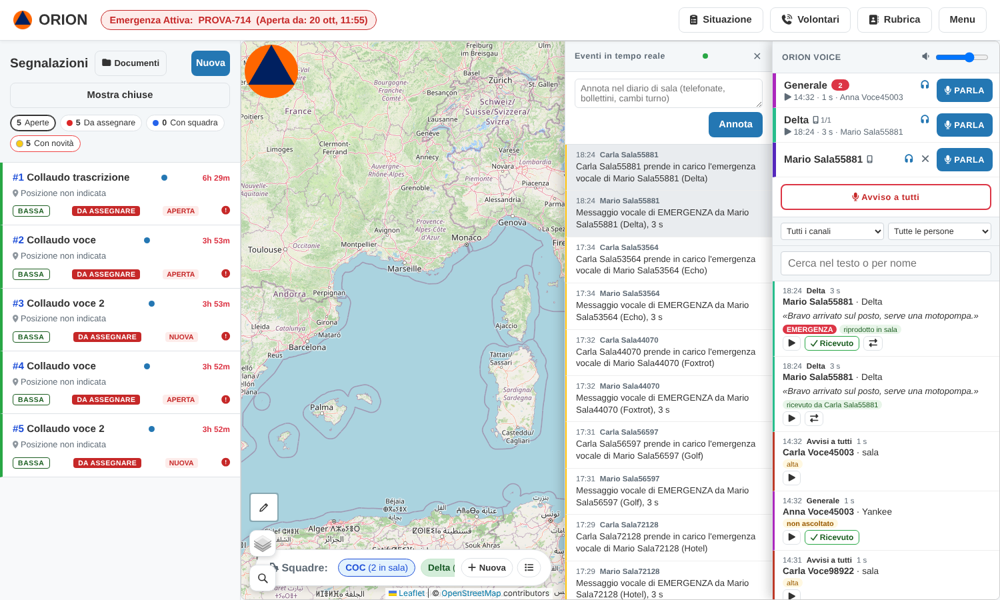

Se Orion Voice è accesa, durante l'emergenza ogni squadra ha un canale
vocale e la sala parla e ascolta dal browser, come con la radio. La voce non
sostituisce la radio: quando la rete del telefono non c'è, la radio resta il
canale principale. In sala sentono e parlano i membri della squadra COC; gli
altri collegati al web non sentono niente.

**Il pannello.** Per chi è in sala il pannello di Orion Voice è sempre aperto
sul lato destro della mappa: la sala ascolta e risponde per tutto il turno, e
chi parla deve vedersi senza aprire niente. La colonna degli eventi si apre
alla sua sinistra, e la mappa si stringe di conseguenza. Chi coordina da fuori
dalla sala ha invece la linguetta Orion Voice sotto quella degli eventi, e la
apre quando serve, al posto degli eventi. Sullo schermo del portatile il pannello si
può **ripiegare** con la doppia freccia in alto: resta una colonna stretta con
la sigla di ogni canale e la spia di chi parla, la voce continua a funzionare
e la mappa si allarga; la freccia opposta lo riapre.

**Attivare l'audio.** Il browser non fa suonare niente finché non si clicca
nella pagina: all'apertura compare una fascia gialla "Attiva Orion Voice"
e la linguetta, se c'è, resta gialla. Il primo clic
attiva l'ascolto; il pulsante della fascia chiede anche il permesso del
microfono, la prima volta, e fa sentire un tono di prova. Finché la fascia
gialla c'è la postazione non sente le squadre: è il primo errore da evitare.
Basta farlo una volta per browser: tornando al centro operativo da un'altra
pagina l'audio riparte da solo o, se il browser non lo permette, al primo clic
o tasto premuto in un punto qualsiasi della pagina.

**Le righe dei canali**: il pannello ne ha una per canale, il generale in cima, poi le
squadre nell'ordine della barra, poi i canali diretti. Ogni riga dice chi sta
parlando (con l'onda), oppure l'ultimo messaggio con ora e durata (un clic lo
riascolta), quanti telefoni della squadra hanno la voce accesa ("2/4") e
quanti messaggi nessuna postazione ha ancora ascoltato (il numero rosso). La
cuffia accende o spegne l'ascolto di quel canale su questa postazione: due
operatori si dividono così le squadre. Se un canale attivo non lo ascolta
nessuna postazione, la riga diventa arancione e lo scrive. Sotto ci sono
"Avviso a tutti", che arriva a tutti i telefoni in priorità alta, e la
cronologia dell'emergenza con il filtro per canale e per persona e la casella
di ricerca, che trova le parole nei testi trascritti e i nomi.

**Parlare.** Si tiene premuto PARLA sulla riga del canale e si parla dopo il
bip; si rilascia per mandare. Con la tastiera si tiene premuto F9 (o il tasto
scelto dall'amministratore nelle impostazioni), che parla sull'ultimo canale
usato con PARLA; all'inizio sul generale. I pedali e i pulsanti USB che si
presentano come un tasto si assegnano allo stesso tasto.
Il tasto funziona solo con la finestra di ORION davanti; se si cambia finestra
mentre lo si tiene premuto il messaggio si chiude lì. Se il canale è occupato
si sente un tono basso e compare chi sta parlando; la sala però può prendere
la parola anche a canale occupato, e chi parlava viene interrotto (il suo
messaggio resta salvato). Un messaggio dura al massimo un minuto: negli ultimi
dieci secondi il riquadro diventa arancione e si sente un bip al secondo.
"Avviso a tutti" va in priorità alta: passa davanti agli altri. In sala
si consiglia una cuffia con microfono: protegge la riservatezza e non fa
rientrare la voce nel microfono. Mentre la sala parla, quello che arriva
aspetta e si sente dopo.

**Ascoltare.** I messaggi si sentono uno alla volta, nell'ordine di arrivo;
alta priorità ed emergenza passano davanti. Il canale in coda lampeggia con
"in attesa, 8 s": un clic lo fa sentire subito. Un messaggio vale come
"riprodotto in sala" quando una postazione l'ha sentito, in diretta o dopo, e
chi ha parlato lo vede sul telefono. "Ricevuto" (o il tasto F8 per l'ultimo
messaggio ascoltato) è la conferma vera: dice al caposquadra che la sala ha
capito e può smettere di ripetere. I messaggi registrati senza rete arrivano
dopo con l'ora vera ("registrato alle 10:42"); quelli più vecchi di due minuti
non partono da soli, restano nella cronologia.

**La barra delle squadre** si accende quando qualcuno della squadra parla, con
il nome sotto la lettera, e mostra il numero di messaggi non ascoltati. Nel
menu della squadra ci sono il tasto grande "Parla ad Alfa" e gli ultimi
messaggi. Nella finestra dei membri, "Diretto" apre un canale solo fra la sala
e quella persona, per le cose da non dire a tutta la squadra; si chiude con la
crocetta sulla sua riga. Sulla mappa la lettera della squadra pulsa mentre
qualcuno parla.

**Nel diario della segnalazione** ogni messaggio di una squadra entra da solo
come nota ("Messaggio vocale da Alfa, 12 s"), legato alla segnalazione su cui
la squadra lavorava quando ha cominciato a parlare. Accanto alla nota c'è il
tasto per ascoltarla e la matita "Scrivi come nota", che prepara ora e autore
nel campo delle note: si scrive il contenuto in due parole. Dalla cronologia
del pannello un messaggio si sposta su un'altra segnalazione: resta
scritto in tutte e due.

**La trascrizione.** Se l'amministratore l'ha accesa, ogni messaggio viene
trascritto dal server qualche secondo dopo la fine, e il testo compare tra
virgolette sotto il messaggio nella cronologia, sotto la nota nel diario
della segnalazione, nella stampa e nel resoconto. È automatica e può
sbagliare nomi e numeri: per le cose importanti fa fede l'audio, che resta
sempre lì da ascoltare. Il testo si cerca dalla casella della cronologia e,
per le emergenze passate, dall'archivio.

**L'emergenza.** Il tasto di emergenza dell'app per ora è tolto, ma i
telefoni non ancora aggiornati lo hanno: un messaggio di emergenza apre una fascia
rossa in cima a tutte le postazioni, con un allarme che tace mentre suona la
voce dell'emergenza. Su una postazione "Ascolta" o "Silenzia" fermano
l'allarme continuo: da lì resta un richiamo ogni trenta secondi finché
qualcuno non preme "Prendo in carico". La fascia mostra chi è, la squadra, il
telefono (se la Segreteria è accesa), "Ascolta" e "Sulla mappa". Chi prende in carico
finisce nel diario di sala, la fascia si chiude su tutte le postazioni e chi
ha chiesto aiuto lo vede sul telefono.

**Se Orion Voice non è collegata** il pannello lo dice in rosso e PARLA non
funziona: ORION riprova da solo, intanto si usa la radio. Per parlare serve
Chrome, Edge o Firefox recente; un browser più vecchio può solo ascoltare.

### La mappa

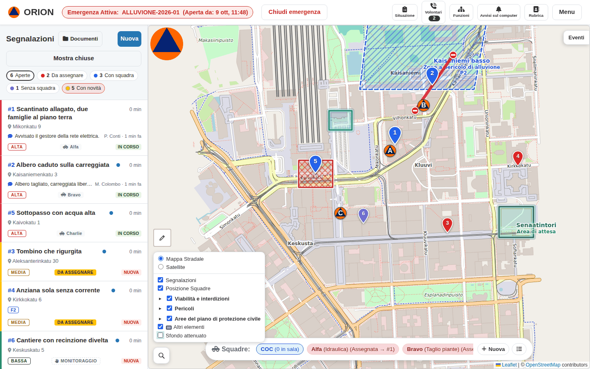

In basso a sinistra ci sono tre pulsanti. La **matita** disegna strade chiuse,
zone interdette, zone di pericolo e aree del piano. I **livelli** scelgono lo
sfondo (stradale o satellite) e cosa mostrare. La **lente** cerca
segnalazioni, squadre, indirizzi e coordinate.

Le strade chiuse sono linee rosse con il segnale di divieto, le zone interdette
sono rosse a quadretti, le zone di pericolo blu (alluvione), marroni (frana) o
arancioni. Le aree di attesa, accoglienza e ammassamento sono verdi e viola.
Cliccando un elemento si leggono i suoi dati e lo si modifica o toglie.

**Radar pioggia**, fra i livelli, mostra la pioggia vista dai radar della
Protezione Civile nazionale, con la scala dei colori in millimetri all'ora.
Il riquadro del radar, in basso accanto ai pulsanti della mappa, dice l'ora
dell'immagine. Il pulsante ▶ fa scorrere l'ultima
ora, un'immagine ogni cinque minuti, e mostra da dove arriva il temporale e
dove va; la barra accanto si trascina per fermarsi su un'ora. Il livello si
aggiorna da solo e, fermo sull'ultima immagine, la segue. Se compare "Radar
fermo alle…" il servizio non manda dati nuovi da più di mezz'ora: quello che
si vede è vecchio. Se compare "Solo l'ultima immagine" l'archivio delle ore
passate non risponde come dovrebbe: ORION mostra lo stesso la pioggia di
adesso, senza animazione, e riprova da solo ogni dieci minuti.

**Fulmini**, fra i livelli, mostra i fulmini caduti nella mezz'ora fino
all'immagine del radar: gialli i più recenti, arancioni quelli di pochi minuti
prima, grigi i più vecchi. Arrivano con una decina di minuti di ritardo e il
Dipartimento li tiene per poco tempo, quindi scorrendo l'ora più indietro
possono mancare: il riquadro lo dice. La neve non ha un livello suo: il radar
la vede come pioggia, di solito più debole del vero. I due livelli restano
accesi o spenti la volta dopo, su quel computer.

**Le squadre nelle zone interdette.** Quando il telefono di una squadra entra
in una zona interdetta, in sala compare l'avviso "Squadra … in zona
interdetta", con il suono degli avvisi urgenti, e il diario di sala lo annota.
Se nella zona c'è l'intervento della squadra l'avviso è senza allarme, perché
entrarci è il lavoro previsto. Lo stesso avviso, con una frase detta a voce, lo
riceve la squadra sul telefono, e già prima di entrare, avvicinandosi. Prima
di partire, inoltre, l'app avverte la squadra se la strada più diretta passa da
una strada chiusa o da una zona interdetta: il navigatore del telefono non le
conosce. Per questo vale la pena disegnare subito le strade chiuse sulla
mappa, anche quelle che sembrano ovvie.

### Chiamare i volontari

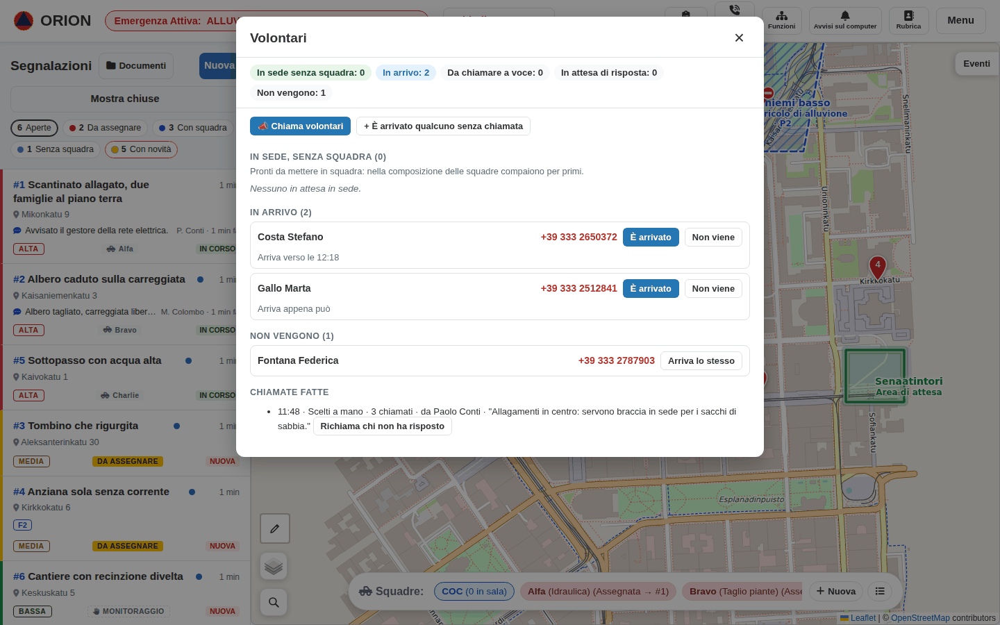

"Volontari" apre il pannello della chiamata. Con "Chiama volontari" si sceglie
chi chiamare (tutti, i reperibili di oggi, chi ha un certo corso, oppure
persone scelte a mano), si scrive un messaggio breve e si decide come avvisare
(app, email o tutti e due). Le persone rispondono dal telefono: "Arrivo
subito", "Fra 30 minuti", "Non posso". Il pannello le divide in da chiamare a
voce, in attesa, in arrivo, in sede e non vengono. Chi arriva lo segna "È
arrivato"; chi si presenta senza chiamata si aggiunge con "È arrivato qualcuno
senza chiamata". Chiama chi apre le emergenze o organizza le attività.

### Le funzioni di supporto

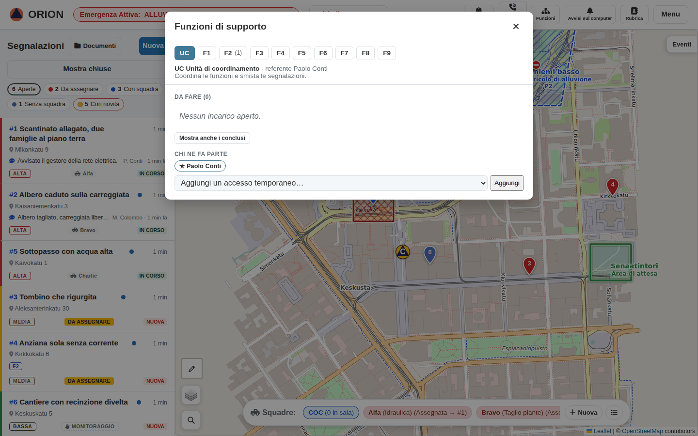

Se il modulo è acceso, la sala lavora per funzioni (metodo Augustus). Dalla
scheda di una segnalazione, "Assegna a una funzione" dà un incarico con il
motivo. Il pannello "Funzioni" mostra per ogni sigla gli incarichi da fare e
chi ne fa parte: si prendono in carico, si annotano e si concludono con
l'esito. Concludere un incarico non chiude la segnalazione.

### Rubrica, situazione e accessi esterni

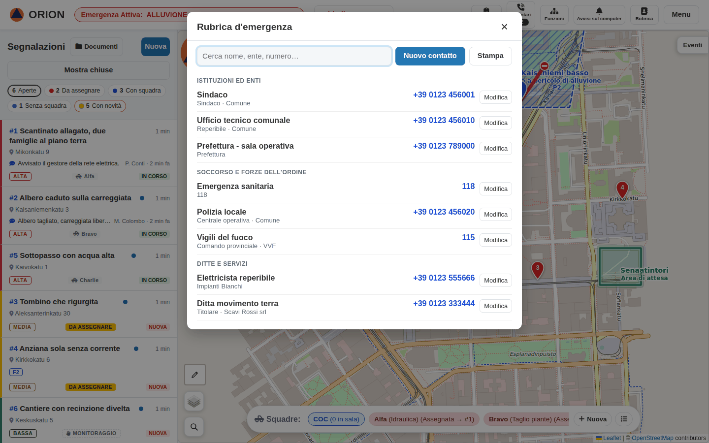

La **Rubrica** raccoglie i numeri utili, divisi per gruppi. Si cerca, si
aggiunge con "Nuovo contatto", si stampa per averla anche senza rete.

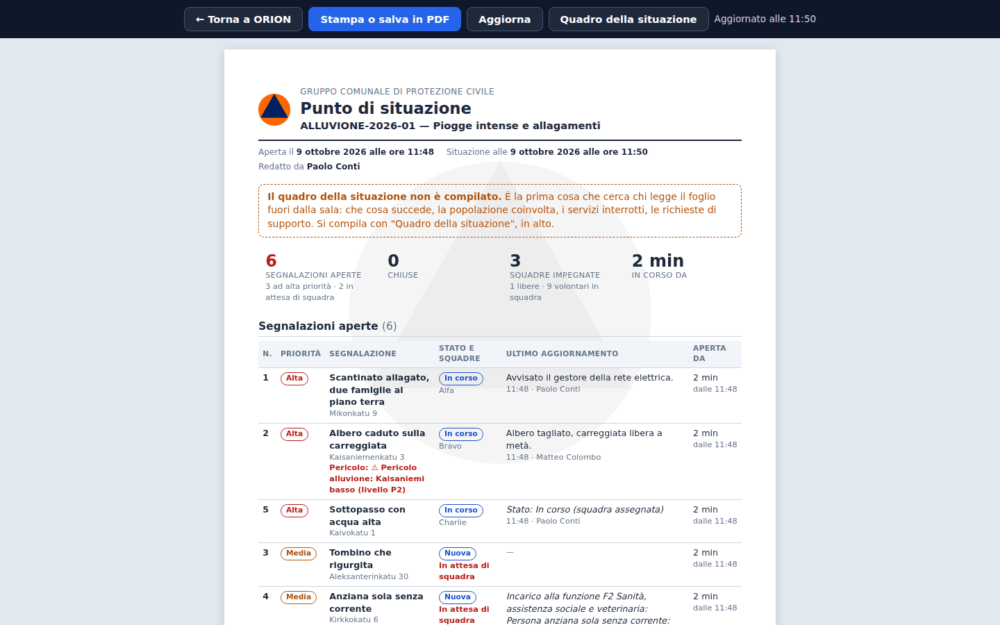

**Situazione** apre il punto di situazione da stampare o salvare in PDF:
numeri, segnalazioni aperte, squadre, funzioni, strade chiuse, ultime note del
diario. "Quadro della situazione" aggiunge in cima quello che chiede chi legge
da fuori: cosa succede, popolazione coinvolta, servizi interrotti, richieste
agli enti, recapiti del COC.

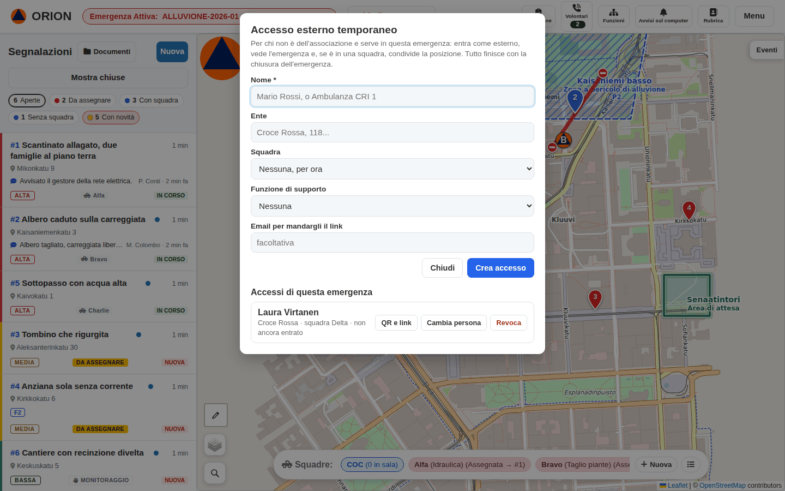

**Accesso esterno** (dal Menu) fa entrare chi non è del gruppo (Croce Rossa,
tecnico comunale) senza account: si scrive il nome, eventualmente ente,
squadra e funzione, e ORION mostra un QR da inquadrare. L'esterno vede solo
l'emergenza e gli interventi della sua squadra. Con la voce accesa sente il
canale della sua squadra da quando entra e ci parla, a meno di togliere la
casella "Può parlare sul canale voce della squadra". L'accesso finisce da solo
alla chiusura; nell'elenco sotto si rimostra il QR, si cambia persona o si
revoca.

**La qualifica.** A chi viene da fuori si può dare una qualifica, facoltativa:
Vigili del Fuoco, gruppo di protezione civile esterno, Polizia Locale, Polizia
di Stato, Carabinieri, soccorso sanitario 118, Croce Rossa Italiana, Soccorso
Alpino, Forze Armate o altro ente. Se l'esterno forma una squadra nuova, la
squadra prende la sua qualifica. Sulla mappa ogni squadra è un cerchio con la
lettera del suo nome radio, unica come il nome: quelle del gruppo sono
arancioni con il triangolo blu, quelle di fuori hanno il colore dell'ente,
un anello bianco e sotto un'etichetta con la sigla.

| Ente | Sigla | Colore |
|---|---|---|
| Vigili del Fuoco | VVF | rosso |
| Gruppo di protezione civile esterno | PC | giallo |
| Polizia Locale | PL | verde petrolio |
| Polizia di Stato | PS | blu |
| Carabinieri | CC | blu notte con anello rosso |
| Soccorso sanitario | 118 | magenta |
| Croce Rossa Italiana | CRI | bianco con scritta rossa |
| Soccorso Alpino | CNSAS | verde |
| Forze Armate | FA | verde militare |
| Altro ente | EN | marrone |

Nella barra delle squadre, nella scheda della segnalazione e sullo schermo a
parete la stessa etichetta sta davanti al nome della squadra. Le icone usano
solo sigle e colori: gli stemmi degli enti, e l'emblema della croce rossa,
sono protetti e non si riproducono.

### Se cade la rete

Se il server non risponde compare una fascia rossa: non si ricarica la pagina.
Si continua a lavorare, le operazioni restano in coda e partono da sole quando
il server torna. Se mancano solo le mappe da internet e l'associazione ha
caricato la cartografia del territorio, la mappa passa da sola al fondo
"Territorio (dal server)".

### Chiudere l'emergenza

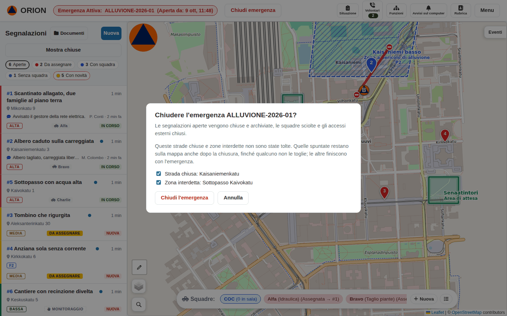

"Chiudi emergenza" chiede conferma ed elenca strade chiuse e zone interdette:
quelle spuntate restano sulla mappa anche dopo. Alla chiusura ORION salva un
backup, scrive il resoconto, chiude le squadre rimaste vuote, termina gli
accessi esterni e mostra il sigillo dello storico, da copiare e conservare.

## 5. La segreteria

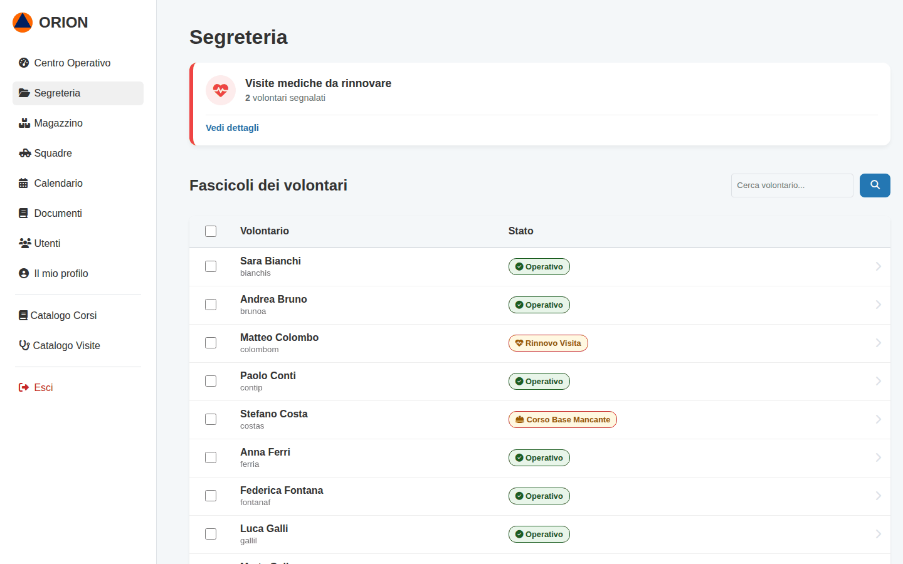

In cima ci sono le scadenze da sistemare, sotto i fascicoli dei volontari con
il loro stato: Operativo (visita e corso base validi), Rinnovo visita, Corso
base mancante, Non operativo, Dati da inserire. Si cerca per nome.

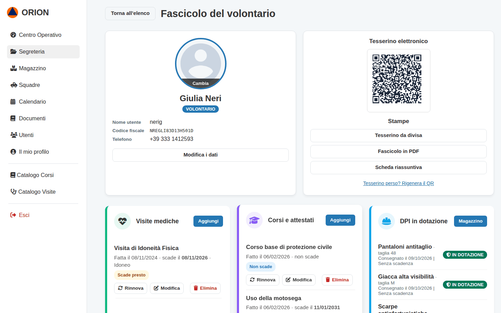

Cliccando una persona si apre il suo fascicolo: dati e "Modifica i dati",
tesserino con il QR e le stampe (tesserino da divisa, fascicolo in PDF, scheda
riassuntiva), poi visite, corsi, DPI e presenze. Ogni visita e corso ha
Rinnova, Modifica ed Elimina. "Tesserino perso? Rigenera il QR" rende inutile
quello vecchio.

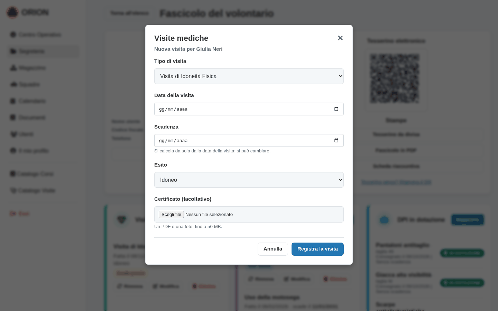

"Aggiungi" registra una visita o un corso: tipo, data, esito, certificato. La
scadenza si calcola da sola dal catalogo e si può cambiare.

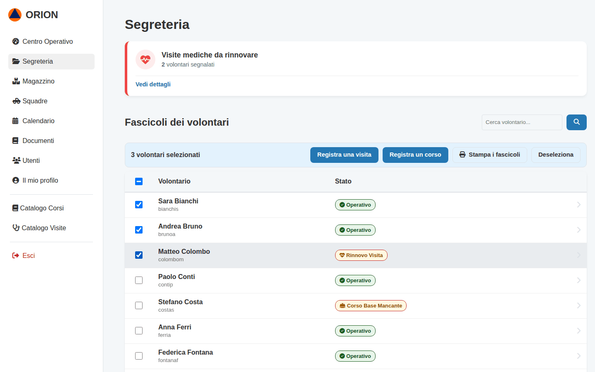

Per la visita collettiva o il corso fatto insieme si spuntano le persone
nell'elenco e si usa "Registra una visita" o "Registra un corso"; la spunta in
testa all'elenco seleziona tutti quelli che si vedono. Con le stesse spunte
"Stampa i fascicoli" prepara un PDF unico, e "Stampa i tesserini" un PDF con
i tesserini di tutti, in ordine di cognome. Le voci **Catalogo Corsi** e
**Catalogo Visite** del menu tengono i tipi con la loro validità.

Il PDF dei tesserini è grande quanto la tessera (CR80, 85,6 per 54 mm), con
una pagina per facciata, ed è fatto per le stampanti di tessere a 300 dpi
come le Evolis, le Zebra o le Fargo: si apre con un lettore PDF e si stampa a
dimensione reale, senza adattarlo alla pagina, in orizzontale e con il nastro
a colori. Se il tesserino ha anche il retro, la finestra chiede l'ordine delle
pagine: fronte e retro di seguito per le stampanti fronte-retro, oppure prima
tutti i fronti e poi tutti i retri per quelle a una facciata, con cui si
stampano le pagine dei fronti, si rimettono le tessere girate nel caricatore e
si stampano quelle dei retri. Conviene provare prima con due tessere, per
vedere in che verso vanno rimesse e se la stampante ne inverte l'ordine. Alla
fine la finestra dice chi è rimasto senza foto.

## 6. Il magazzino

Il magazzino tiene DPI, attrezzature e mezzi. Le giacenze non si scrivono a
mano: le calcola ORION dai movimenti. Consegna e Rientro sono di chi ha il
permesso di consegnare (il magazziniere); Inventario, Verbali e registro e
Impostazioni di chi gestisce il magazzino. Gli altri interni vedono Chi ha cosa
e Scade e manca.

### Consegna

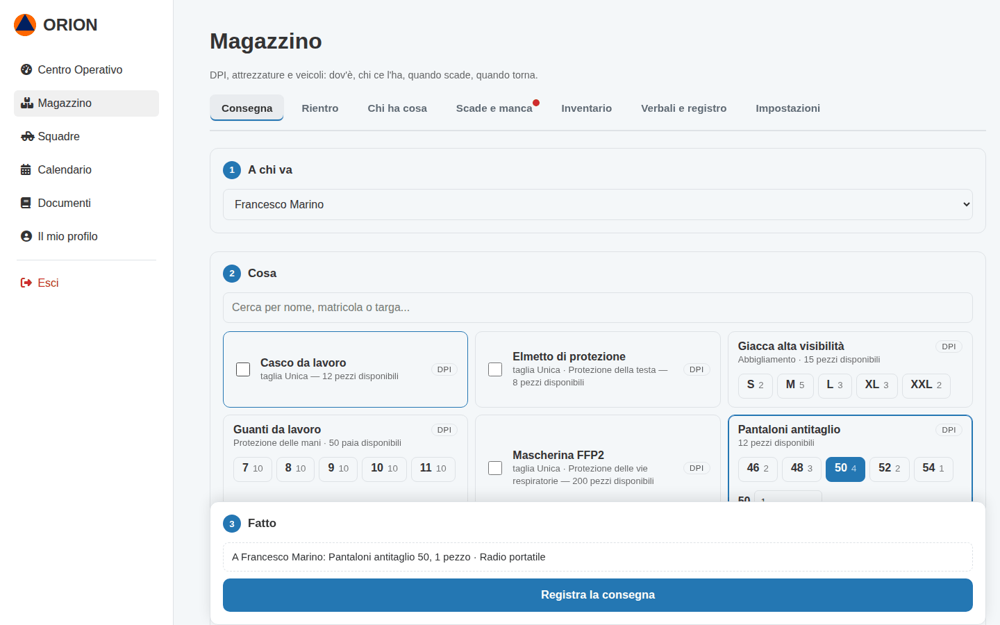

Tre passi. **A chi va**: si sceglie la persona (sotto compaiono le taglie che
ha già ricevuto). **Cosa**: si spuntano gli oggetti; per un DPI si tocca la
taglia e si dice quanti. La taglia della persona è segnata in verde ("Sua
taglia"), oppure in verde tratteggiato quella dedotta da un DPI simile.
**Fatto**: il riepilogo e "Registra la consegna". Il riquadro finale resta in
fondo allo schermo mentre si scorre. Se l'associazione usa il verbale, compare
la casella per prepararlo.

### Rientro

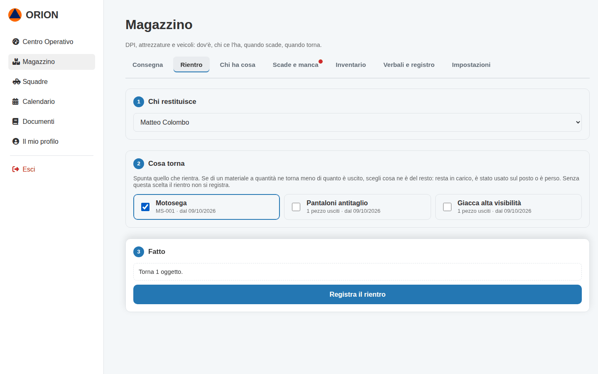

Si sceglie chi restituisce, si spunta cosa torna e quanto. Se di un materiale
a quantità ne torna meno, ORION chiede cosa ne è del resto: resta in carico, è
stato usato o è perso. Per i mezzi si possono scrivere i chilometri.

### Chi ha cosa, Scade e manca

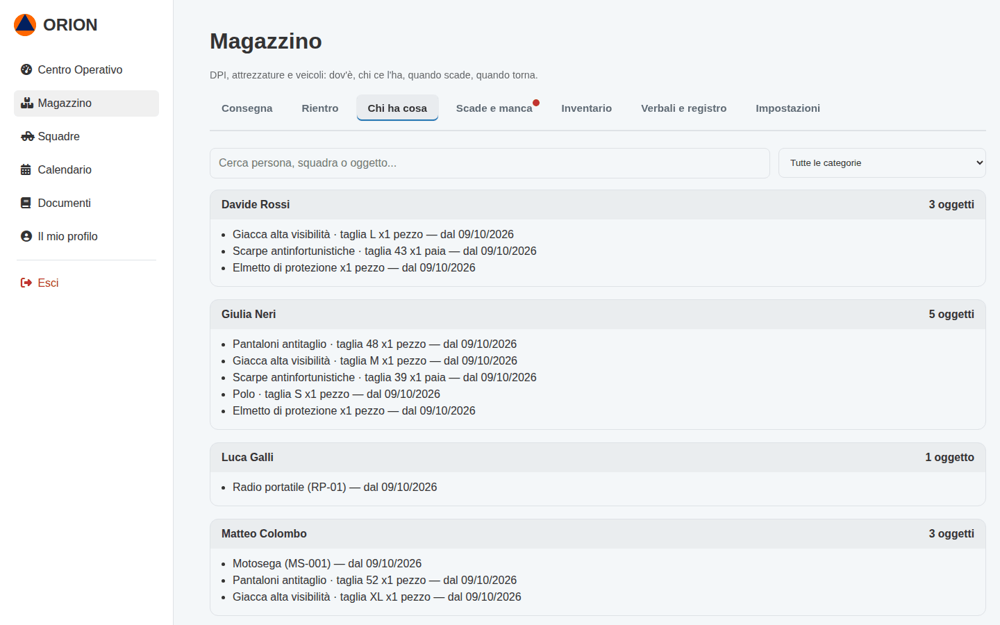

**Chi ha cosa** elenca per persona il materiale in carico, con la taglia e la
data. Si cerca per persona o oggetto.

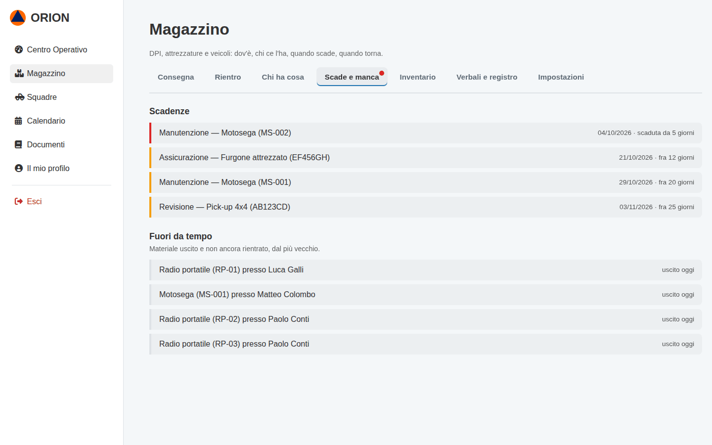

**Scade e manca** mostra revisioni, assicurazioni, manutenzioni e scadenze dei
DPI, in rosso quelle passate, e il materiale fuori da troppo tempo. Il pallino
rosso sulla scheda dice che c'è qualcosa da guardare.

### Inventario e scheda di un bene

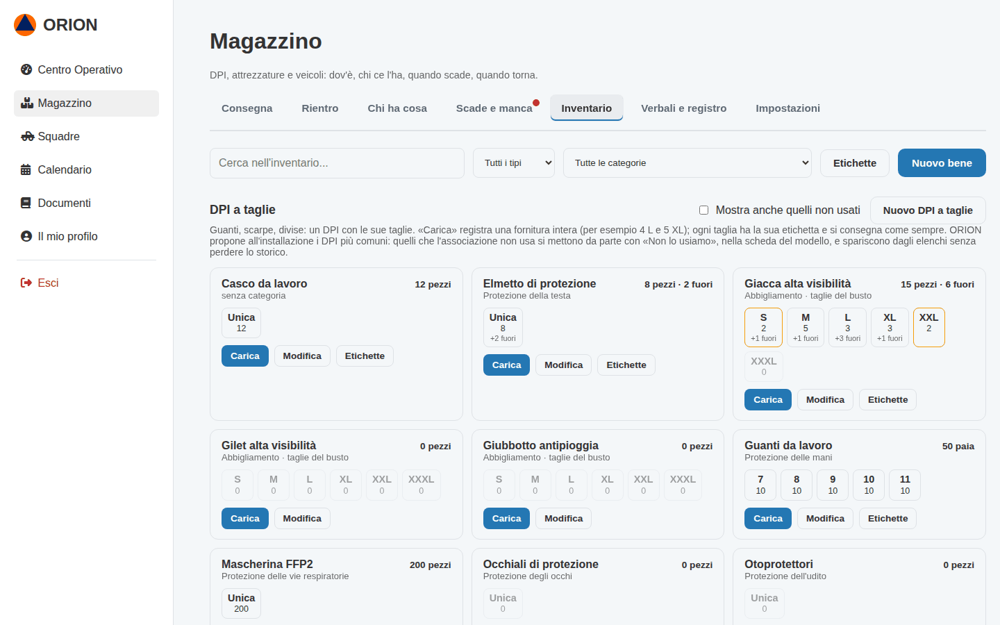

L'**Inventario** ha in alto i DPI a taglie, uno per modello, con le quantità per
taglia e i pulsanti Carica (arriva una fornitura), Modifica ed Etichette. Sotto
ci sono attrezzature e mezzi. "Nuovo bene" e "Nuovo DPI a taglie" li creano. I
DPI proposti da ORION che il gruppo non usa si nascondono con "Non lo usiamo".

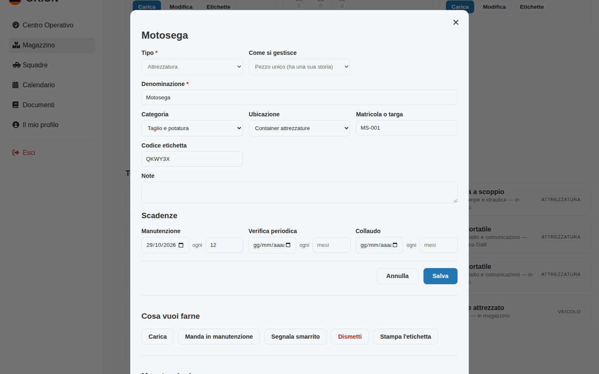

La **scheda** si apre cliccando un bene: dati, categoria, ubicazione,
matricola, codice dell'etichetta e scadenze, con ogni quanti mesi si
rinnovano. Sotto "Cosa vuoi farne" ci sono Consegna questo, Carica, Manda in
manutenzione, Segnala smarrito, Dismetti e Stampa l'etichetta. Più in basso le
manutenzioni, i libretti collegati e la storia. Un bene non si cancella mai: si
dismette.

### Etichette QR

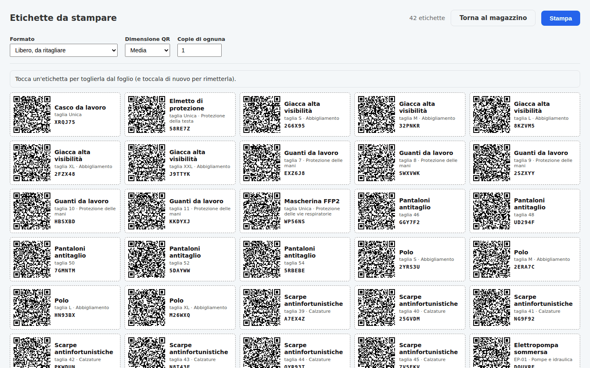

"Etichette" stampa i QR dei beni, su foglio libero o su fogli adesivi A4, con
le copie, le posizioni da saltare e la correzione in millimetri. Il QR
inquadrato con il telefono apre la scheda del bene; se non si è entrati, prima
chiede l'accesso e poi torna al bene. Su Android la pagina propone "Apri
nell'app". Dalla scheda, "Consegna questo" apre la consegna con l'oggetto già
scelto.

### Verbali, registro e impostazioni

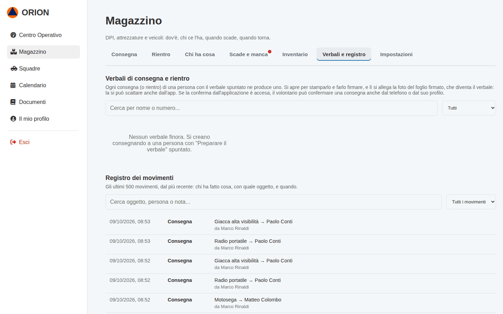

**Verbali e registro** raccoglie i verbali di consegna e rientro (da stampare,
o con la foto del foglio firmato) e tutti i movimenti, con chi li ha fatti.

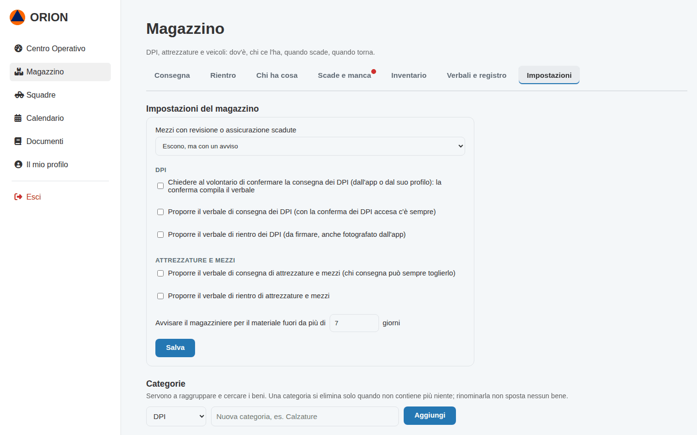

Nelle **Impostazioni** si decide se i mezzi scaduti possono uscire, se chiedere
la conferma dei DPI dall'app o dal profilo, quali verbali proporre (separati
per DPI e per attrezzature e mezzi) e dopo quanti giorni segnalare il materiale
fuori. Sotto si gestiscono categorie, ubicazioni e i propri avvisi via email.

## 7. Le squadre

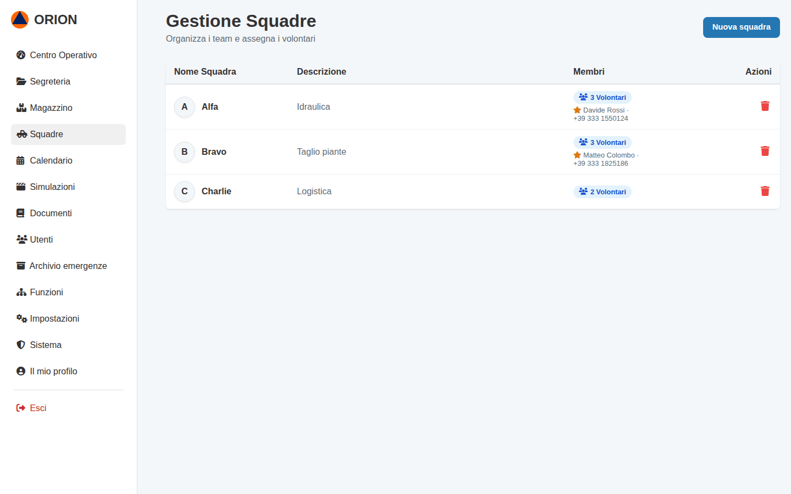

L'elenco delle squadre con nome radio (Alfa, Bravo, Charlie...), descrizione,
membri e caposquadra con il telefono. Cliccando una squadra se ne vedono i
membri; il cestino la scioglie se non è impegnata.

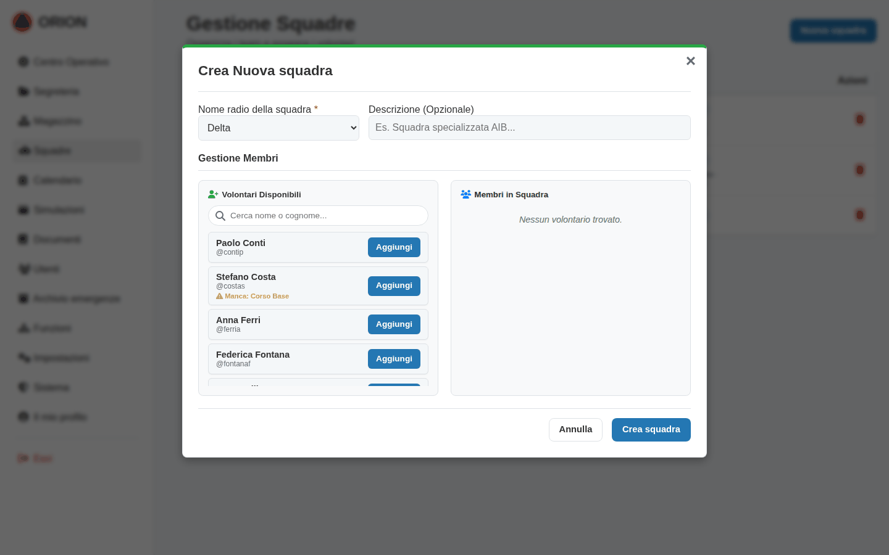

"Nuova squadra": si sceglie il nome radio, si scrive la descrizione e si
aggiungono i volontari dall'elenco di sinistra. La stella accanto a un membro
lo nomina caposquadra. Una persona sta in una squadra sola. Le squadre le
compone qualunque interno; ogni cambio resta nel registro. "Da dove viene"
dà alla squadra una qualifica (Vigili del Fuoco, Polizia Locale, gruppo di
protezione civile esterno...) quando non è del gruppo: in sala si distingue
dalle altre. La qualifica resta anche nello storico delle segnalazioni, dopo
che la squadra si è sciolta.

## 8. Il calendario

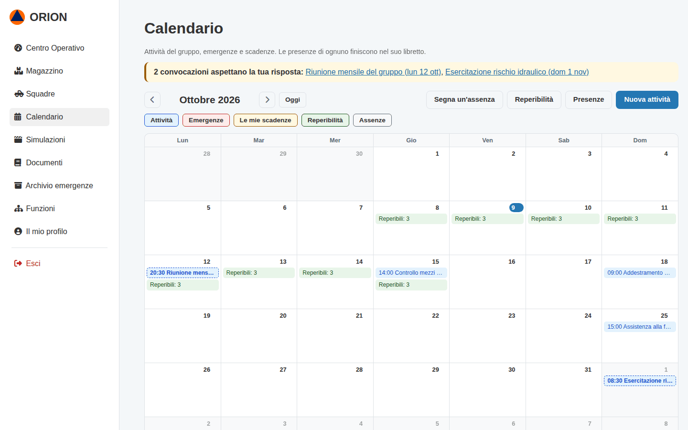

La griglia del mese con attività, emergenze, scadenze e reperibilità; i filtri
sopra accendono e spengono le categorie. In cima una fascia ricorda le
convocazioni a cui rispondere. I pulsanti:

| Pulsante | Cosa fa |
|---|---|
| Segna un'assenza | I giorni in cui non ci sei: le chiamate generali non ti arrivano |
| Reperibilità | Mette le persone di turno (chi organizza) |
| Presenze | Il riepilogo dell'anno, scaricabile (chi organizza o gestisce l'anagrafica) |
| Nuova attività | Crea un'attività (chi organizza) |

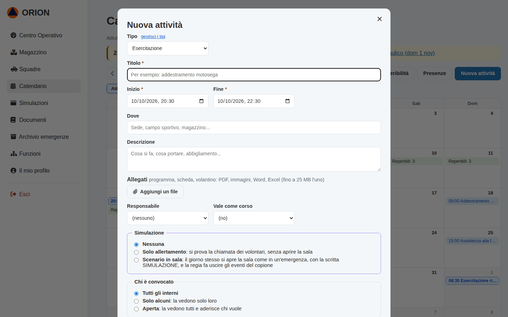

**Nuova attività** (o clic su un giorno): tipo, titolo, inizio e fine, luogo,
descrizione, allegati, responsabile. Un addestramento può valere come corso
del catalogo. La **convocazione** può essere per tutti gli interni, per alcuni
scelti, oppure aperta (aderisce chi vuole, fino ai posti). Si sceglie se
avvisare con l'app, con l'email o in nessuno dei due modi. Per addestramenti ed
esercitazioni c'è la **simulazione**: solo allertamento (si prova la chiamata)
o scenario in sala.

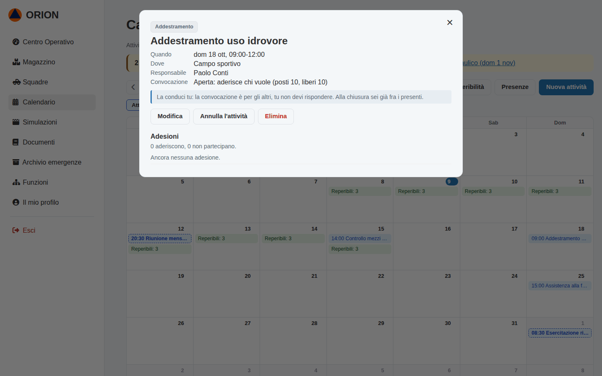

Cliccando un'attività si legge la scheda e si risponde **Partecipo** o **Non
partecipo**. Chi organizza vede le risposte, modifica, annulla, elimina e, a
fine attività, **chiude con i presenti**: le ore finiscono nel libretto di
ognuno, con l'attestato in PDF.

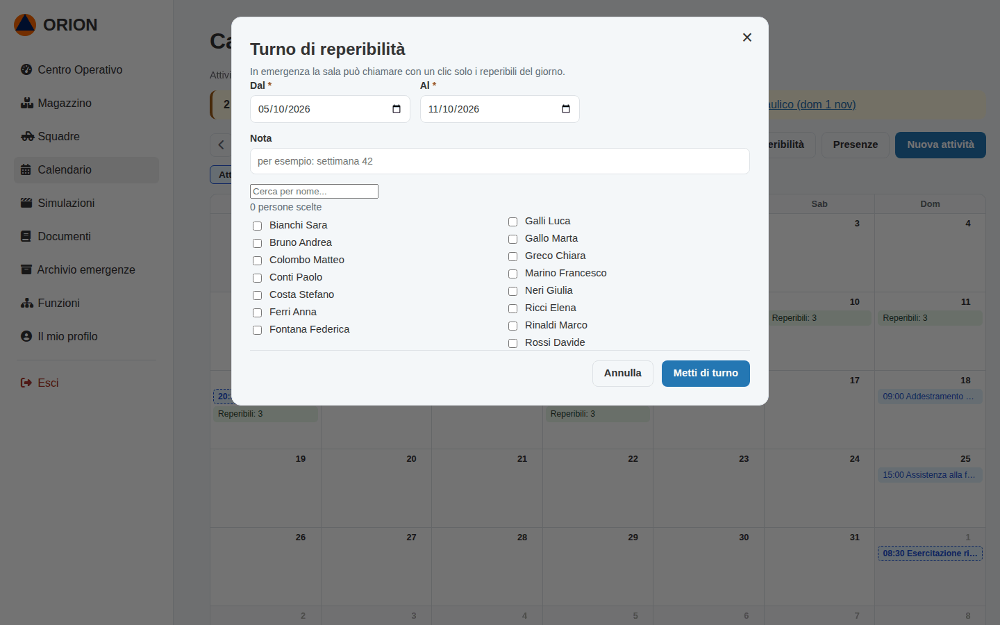

Il **turno di reperibilità** si fa scegliendo le persone e i giorni. In
emergenza la sala chiama con un clic i reperibili del giorno.

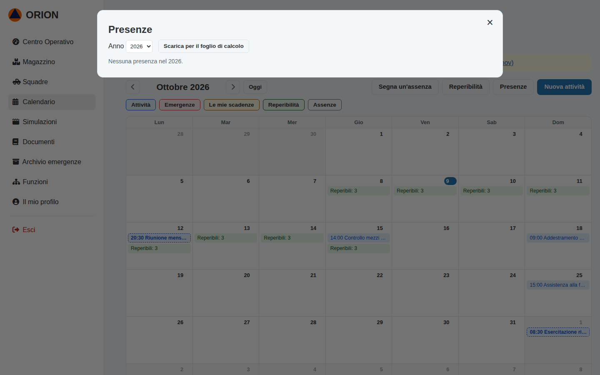

**Presenze** mostra per l'anno quante emergenze, attività e ore ha ciascuno, e
scarica il foglio di calcolo. Le presenze in emergenza le calcola ORION da sé,
dal tempo passato in squadra.

## 9. Le simulazioni

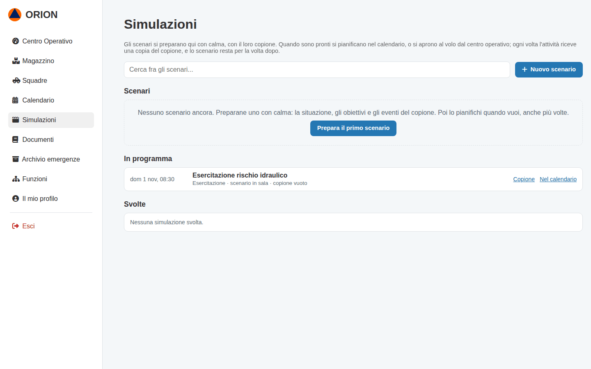

È l'archivio degli scenari per addestramenti ed esercitazioni, preparati con
calma e usati quando servono. Sotto ci sono le simulazioni in programma e
quelle svolte.

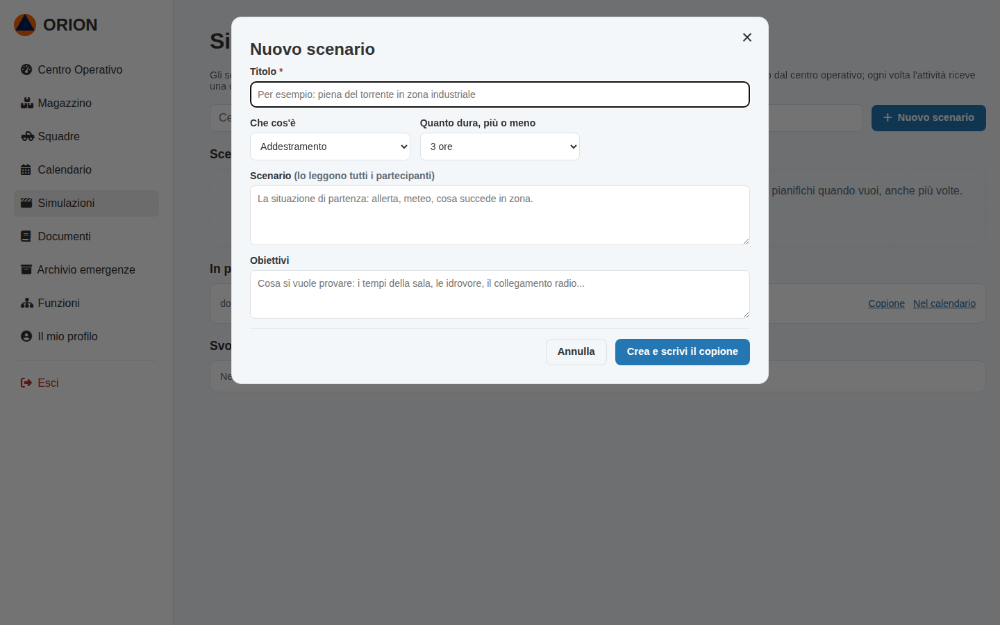

**Nuovo scenario**: titolo, tipo, durata, la situazione di partenza per i
partecipanti e gli obiettivi. Poi si scrive il copione. "Pianifica" lo mette
nel calendario come attività.

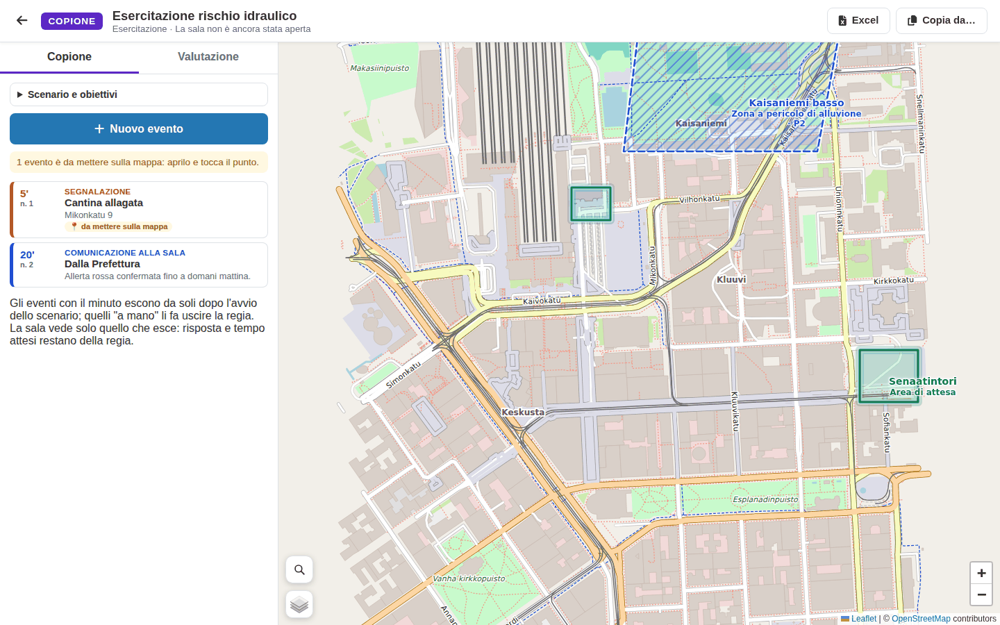

Il **copione** è l'elenco degli eventi, su una mappa come quella della sala.
"Nuovo evento" chiede cosa succede (segnalazione, aggravamento, comunicazione
alla sala, imprevisto per una squadra, strada chiusa, zona) e quando esce: a un
certo minuto o a mano. Il copione si può scrivere anche in Excel ("Excel",
scarica il modello e ricarica il foglio) o copiare da un altro ("Copia da").

**Il giorno della simulazione** la sala si apre dalla scheda dell'attività con
"Apri la sala" (oppure al volo con "Simulazione" dal centro operativo). Tutto
funziona come in un'emergenza, ma con la fascia viola SIMULAZIONE ovunque. La
regia, dal pulsante "Regia", avvia lo scenario, fa uscire gli eventi e prende
nota. A sala chiusa, la scheda **Valutazione** del copione mostra i tempi della
sala e raccoglie il debriefing. Se arriva un'emergenza vera, "Emergenza reale"
ferma la simulazione e la apre subito.

## 10. I documenti

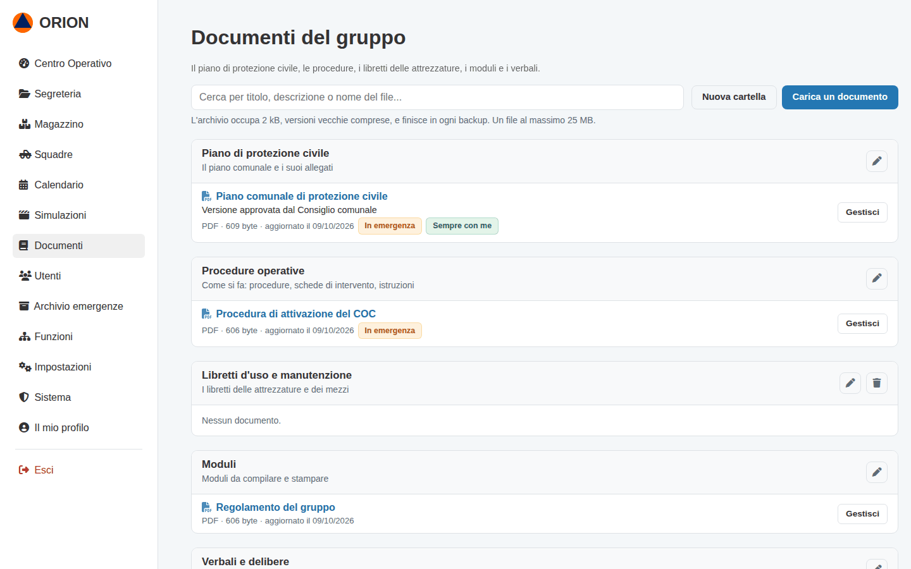

Il piano di protezione civile, le procedure, i libretti dei mezzi, i moduli e i
verbali, divisi in cartelle. Si cerca per titolo o contenuto; il titolo apre il
documento. Due segni dicono come si comporta: **In emergenza** (lo vedono anche
gli esterni durante l'emergenza) e **Sempre con me** (l'app lo tiene sul
telefono, leggibile senza rete).

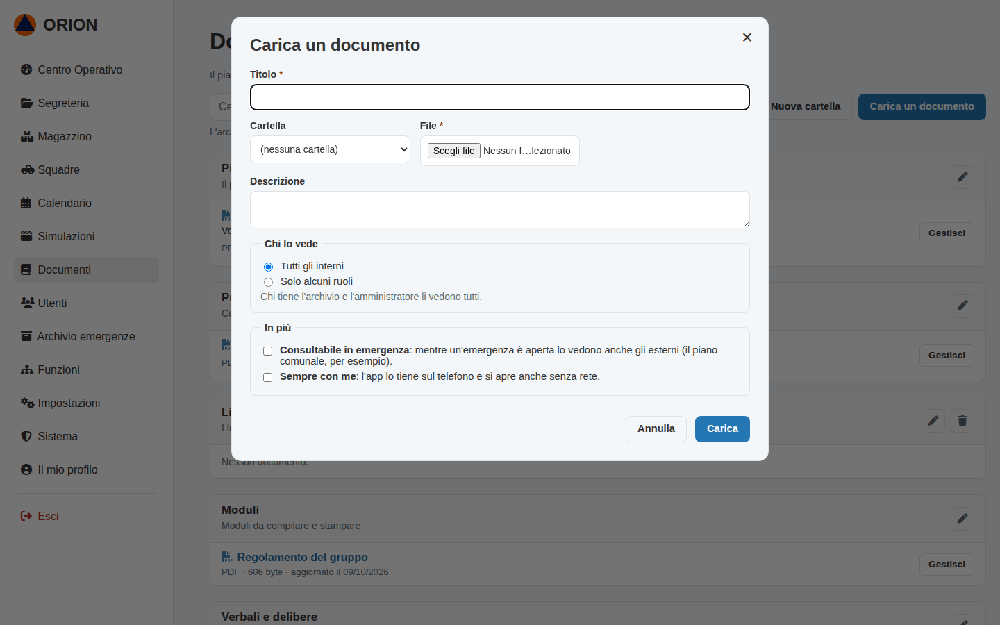

Chi tiene l'archivio usa "Carica un documento": titolo, cartella, file (fino a
25 MB), chi lo vede (tutti gli interni o solo alcuni ruoli) e i due segni
detti sopra. "Gestisci" carica una versione nuova, modifica i dati o toglie il
documento. "Nuova cartella" ne aggiunge una.

## 11. Gli utenti

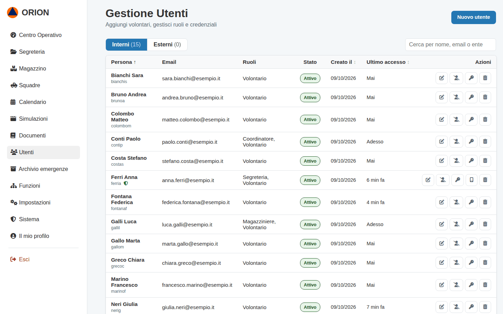

Le schede **Interni** ed **Esterni**, la ricerca e per ogni persona i ruoli, lo
stato, la data di creazione e l'ultimo accesso. Lo scudo verde accanto al nome
indica la verifica in due passaggi. I pulsanti sulla riga: modifica, sospendi
o riattiva, nuova password, azzera la verifica in due passaggi, elimina.
Sospendere toglie l'accesso e lascia tutto; eliminare cancella i dati
personali e tiene solo il nome dove serve allo storico.

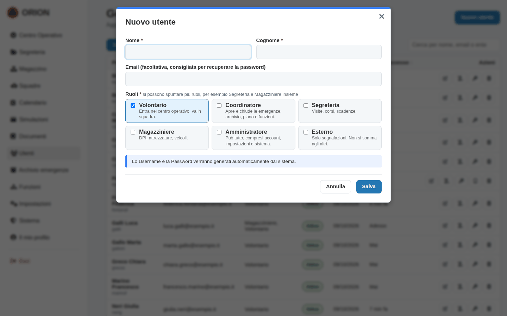

**Nuovo utente**: nome, cognome, email e ruoli. ORION crea il nome utente e il
link di attivazione, che si manda per email o si stampa sul foglio con il QR.
Per un esterno permanente (il referente dei Vigili del Fuoco che lavora spesso
con il gruppo, per esempio) compaiono anche l'ente e la qualifica; nella
colonna Ente dell'elenco c'è il suo bollino.
In fondo alla pagina **Importa da file** iscrive molti volontari da un foglio
Excel o CSV con le colonne Nome e Cognome (ed eventualmente Email, Telefono,
Codice fiscale).

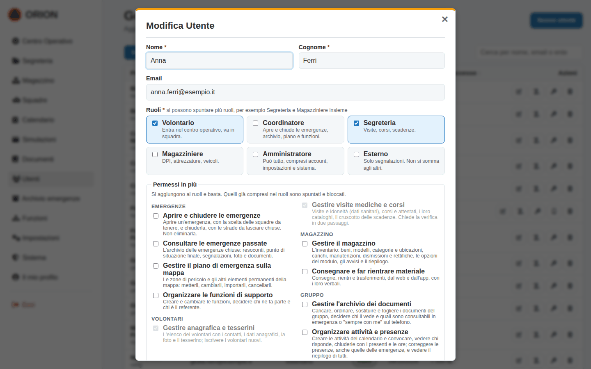

**Ruoli e permessi.** I ruoli sono pacchetti di permessi. Chi ha bisogno di un
solo compito riceve il permesso singolo in "Permessi in più", senza il ruolo
intero.

| Ruolo | Cosa può fare in più del volontario |
|---|---|
| Volontario | Centro operativo, rubrica, documenti, calendario, i propri dati |
| Coordinatore | Aprire e chiudere emergenze, archivio, piano sulla mappa, funzioni di supporto, organizzare attività |
| Segreteria | Anagrafica e tesserini, visite mediche e corsi |
| Magazziniere | Gestire il magazzino, consegnare e far rientrare materiale |
| Amministratore | Tutto, più account, impostazioni, backup e aggiornamenti |
| Esterno | Solo l'emergenza in corso |

Il permesso di gestire l'archivio dei documenti non è in nessun ruolo tranne
l'amministratore: si dà a chi tiene l'archivio.

## 12. L'archivio delle emergenze

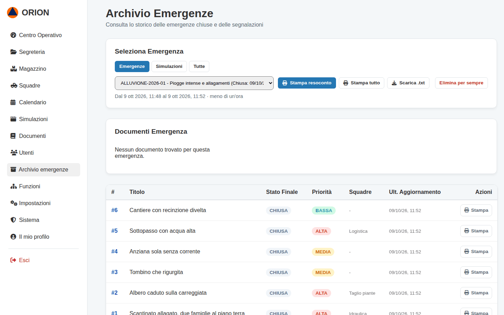

Si sceglie un'emergenza chiusa (o una simulazione) e si vedono le segnalazioni
con l'esito. **Stampa resoconto** prepara il riepilogo, **Stampa tutto**
aggiunge ogni segnalazione con diario e foto, **Scarica .txt** dà il testo.
**Foglio di calcolo** scarica le segnalazioni in un file CSV che Excel apre
così com'è: numero, tipo, titolo, indirizzo, coordinate, priorità, stato
finale, squadre, apertura, chiusura e numero di note. **Mappa (GeoJSON)**
scarica le segnalazioni con il loro punto e le strade chiuse e le zone
dell'emergenza, da aprire in QGIS. Sono i file da mandare alla Regione o alla
Prefettura; ogni scaricamento resta nel registro delle operazioni.
"Elimina per sempre" toglie l'emergenza per fare spazio: nello storico resta
scritto chi l'ha fatto, e se ne vanno anche i messaggi vocali.

Se il drone ha trasmesso, **Riprese del drone** elenca le registrazioni con
il nome del drone, l'ora, la durata e il peso: "Guarda" le apre nella pagina,
"Scarica" le salva. Ogni visione finisce nel registro delle operazioni.

Se l'emergenza ha messaggi vocali, **Comunicazioni vocali** li elenca con
canale, autore, durata e conferme, e ognuno si ascolta o si scarica; anche le
note vocali del diario delle segnalazioni si ascoltano da lì. Ogni ascolto
finisce nel registro delle operazioni. Il resoconto ha una sezione con il
numero di messaggi per squadra e quelli legati alle segnalazioni, ma l'audio
non c'è: si scarica a parte, da qui.

## 13. Le funzioni di supporto

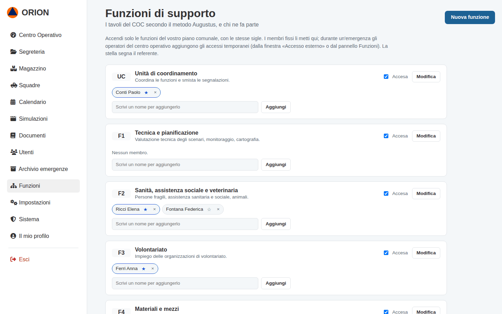

Le funzioni del piano comunale, dall'unità di coordinamento alla F9. ORION
parte con un elenco tipico, ma ogni comune ha il suo piano e le sue funzioni
possono avere numeri e nomi diversi: si adattano qui. **Modifica** cambia sigla,
nome e descrizione di una funzione (per esempio la F1 che diventa
"Volontariato"); le frecce la spostano su o giù nell'elenco; **Nuova funzione**
ne aggiunge una. Due funzioni non possono avere la stessa sigla. Quelle che il
piano non prevede si spengono con la casella "Accesa" e spariscono dalla sala;
si spengono invece di cancellarle, perché gli incarichi del passato le
nominano ancora.

Il nome nuovo vale subito ovunque: nel pannello Funzioni del centro operativo,
negli incarichi, nel diario e nelle stampe, anche per le emergenze passate.
Conviene quindi sistemare le funzioni prima di un'emergenza, non durante. La
pagina si apre anche a modulo spento, dal collegamento nelle Impostazioni:
così le funzioni si preparano prima di accenderlo.

Sotto ogni funzione si aggiungono i membri; la stella segna il referente.

## 14. Le impostazioni

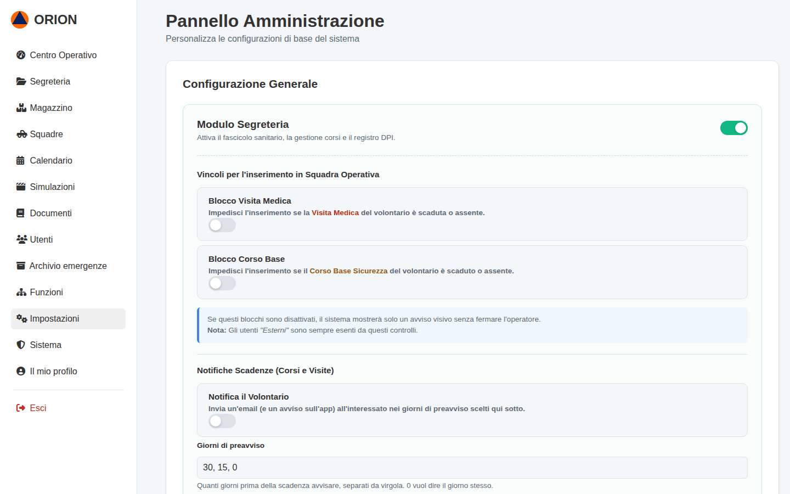

Si fanno una volta, all'inizio. A sinistra l'indice resta fermo mentre la
pagina scorre. I moduli si accendono e spengono subito; per il resto, appena
si cambia qualcosa compare in basso la barra con "Salva" e "Annulla", e
uscendo dalla pagina con modifiche non salvate ORION chiede conferma. In
ordine:

| Sezione | Cosa si decide |
|---|---|
| Moduli | Segreteria (con i blocchi su visita e corso), Magazzino, Funzioni di supporto, Attività e calendario, Orion Voice (con il tasto PARLA predefinito delle postazioni e la trascrizione: spenta, veloce, equilibrata o accurata), Drone (con il massimo di droni in onda insieme e le porte da aprire) |
| Tesserino QR pubblico | Accendere o spegnere i QR dei volontari |
| App Android | Se l'app è a disposizione del personale |
| Nome e logo | Il nome dell'associazione e il logo |
| Tesserino | Distretto, ente, codice fiscale, logo; "Personalizza l'aspetto" apre il configuratore |
| Mappa | Il centro e lo zoom iniziali |
| Centro operativo | Dopo quanti minuti una segnalazione senza squadra diventa rossa |
| Bollettino di allerta | La Regione, il comune di riferimento e da che livello avvisare chi apre le emergenze |
| Posta | Il server della posta in uscita, con "Manda una prova" |
| Condizioni d'uso | Il testo da accettare e chi non l'ha ancora fatto |
| Livelli del piano | Zone di pericolo e aree importate da QGIS, cartografia per lavorare senza internet |
| Registro operazioni | Chi ha fatto cosa, con filtri |

**Il tesserino.** "Personalizza l'aspetto" apre il configuratore: si
trascinano gli elementi, si cambiano misure, colori e testi, e l'anteprima è
disegnata come la stampa. Il retro è facoltativo: finché è vuoto il tesserino
ha una facciata sola. Scelto il QR, il codice fiscale, la scritta centrale, i
loghi o una bandiera, la spunta "Sul retro" lo sposta dietro, e da quel
momento ogni tesserino ha due pagine, prima il fronte e poi il retro; i
pulsanti Fronte e Retro sopra l'anteprima mostrano l'una o l'altra facciata.
Il codice fiscale sul retro, per esempio, lascia sul fronte il posto per un QR
più grande.

**La trascrizione di Orion Voice.** Si sceglie nel riquadro di Orion Voice e
si conferma con "Applica". Gira sul server dell'associazione, senza servizi
esterni; la prima volta il server scarica il modello, e la pagina mostra
l'avanzamento. "Veloce" (142 MB) va bene su quasi tutti i server, "Equilibrata"
(466 MB) sbaglia meno, "Accurata" (547 MB) è la migliore ma chiede circa un
giga e mezzo di memoria e un processore recente. Dopo i primi messaggi la
pagina dice quanti secondi di calcolo servono per ogni secondo di voce: sopra
uno, durante un'emergenza intensa i testi arrivano sempre più in ritardo, e
conviene un modello più veloce. Il parlato si sente comunque subito: la
trascrizione viene dopo e non rallenta la voce. Un modello per cui la memoria
del server non basta è segnato "non bastano" e non si può applicare; chi
gestisce il server può dargliene di più. Se un messaggio non viene trascritto
la pagina dice perché, e cambiando modello i messaggi rimasti indietro
nell'ultimo giorno si rifanno con quello nuovo.

**La posta.** Con Gmail serve una "password per le app", creata da
myaccount.google.com/apppasswords con la verifica in due passaggi attiva.
Host smtp.gmail.com, porta 465, SSL/TLS sì. "Manda una prova" prova prima di
salvare e, se non va, dice perché.

**Il bollettino di allerta.** Finché la Regione è "Spento" ORION non lo legge.
Scelta la Regione, la zona d'allerta si ricava dal **comune di riferimento**
oppure, lasciando "Dal centro della mappa", dal punto in cui è centrata la
mappa; sotto la scelta ORION dice in che zona cade. "Avvisa chi apre le
emergenze" manda una notifica nell'app quando un bollettino nuovo porta la
zona a quel livello, oggi o domani. "Leggi il bollettino ora" salva la scelta,
scarica subito il bollettino e mostra cosa ha trovato. Ci sono tutte le
Regioni; per il Trentino-Alto Adige le due zone sono le due Province
autonome. Se il comune scelto è diviso fra due zone d'allerta (succede per
esempio a Perugia e a Cagliari), vale quella in cui cade il centro della
mappa, e la pagina lo scrive sotto la scelta.

**Livelli del piano.** Le zone si esportano da QGIS in GeoJSON (o KML) con
sistema EPSG:4326; ORION chiede cosa rappresentano e quale campo contiene nome
e livello. La **cartografia del territorio** è un file MBTiles a tasselli
raster (preparato con QGIS): con quella la mappa funziona anche senza internet.

## 15. Il sistema

In alto lo stato: ultimo backup, backup disponibili, spazio, copia dei file
e, se il server ha il disco esterno, l'ultima copia lì (gialla dopo una
settimana, rossa dopo due). Poi la versione e gli aggiornamenti: "Controlla
adesso" dice se c'è una versione nuova e la installa. L'aggiornamento lo fa il
server: la pagina mostra i suoi passi, e se chi gestisce il server ha chiesto
di approvarli resta in attesa finché non lo fa. Con un'emergenza aperta non
si aggiorna.

**Cifratura.** Certificati, documenti, foto e backup sono cifrati con una
chiave che sta sul server. "Mostra la chiave di recupero" la fa vedere: va
stampata e conservata fuori dal server. Senza, se il server si rompe i dati
cifrati non si recuperano.

**Integrità dello storico.** Note, diario, registro e movimenti non si
cancellano e sono legati in una catena: "Verifica adesso" controlla che
nessuno li abbia toccati. Il **sigillo** è l'impronta della catena: si
scarica, si conserva fuori dal server e si confronta in seguito.

**Orion Voice.** Se il modulo è acceso, il riquadro dice quanti messaggi vocali ci
sono nell'emergenza in corso (o nell'ultima), il ritardo medio della voce,
quanti sono arrivati in differita perché registrati senza rete o finiti dopo
una caduta, e quanti telefoni e postazioni sono collegati. Sono i due numeri
che dicono se la voce funziona sul campo: un ritardo che resta sopra un
secondo e mezzo, o molti messaggi in differita, vogliono dire che la rete
della zona non regge e la radio va tenuta come canale principale.

**Notifiche Firebase.** Facoltative. Di base l'app riceve gli avvisi restando
in ascolto del server, con la notifica fissa "Avvisi attivi" sul telefono. Chi
vuole avvisi più puntuali, anche sui telefoni che chiudono le app da soli,
crea un progetto Firebase dell'associazione seguendo la guida del riquadro
(circa un quarto d'ora, una volta sola), carica `google-services.json` e la
chiave dell'account di servizio e preme **Attiva**. ORION controlla con
Google che la chiave funzioni prima di salvarla. Da lì i telefoni passano a
Firebase la prossima volta che si collegano; quelli senza Google Play restano
come prima. A Google non va il contenuto delle notifiche, solo un segnale
vuoto. Il riquadro dice quanti telefoni sono registrati e quando è partito
l'ultimo segnale; **Manda una prova al mio telefono** e **Spegni Firebase**
fanno quello che dicono. Spento Firebase, i telefoni tornano da soli al
collegamento di sempre.

**Backup.** Il server ne fa uno ogni notte e ORION uno a ogni chiusura
d'emergenza. "Fai un backup adesso", Scarica, Verifica, Ripristina. Il
ripristino chiede la password e la parola RIPRISTINA, e prima salva i dati
attuali. Se il server non ha il disco esterno, ogni tanto va scaricata una
copia e tenuta altrove.

**Tornare a una versione precedente.** Se un aggiornamento dà problemi, nel
riquadro della versione c'è l'elenco delle versioni già usate, una per riga.
**Torna a questa** chiede la password e la parola TORNA. Di base i dati
restano quelli di adesso: si tolgono solo le parti del database aggiunte dalle
versioni successive, e la finestra dice quali. Con **Riporta anche i dati a
com'erano** si torna anche ai dati del momento dell'aggiornamento: quello che
è stato fatto dopo sparisce (resta nel backup fatto prima di tornare
indietro). Per tornare
avanti basta aggiornare di nuovo. Con un'emergenza aperta non si può.

## 16. Quando qualcosa non va

| Cosa succede | Cosa fare |
|---|---|
| La password non va | "Hai dimenticato la password?" o un link nuovo dall'amministratore |
| "Troppi tentativi sbagliati per questo account" | Aspettare il tempo indicato e riprovare con calma, o chiedere un link nuovo |
| La password nuova viene rifiutata | Il messaggio dice perché: meglio una frase o più parole che non stanno insieme |
| Il codice a sei cifre viene rifiutato | L'ora del telefono deve essere automatica; altrimenti un codice di riserva |
| La richiesta non arriva sul telefono | Aprire l'app ORION: compare da sola; "Manda di nuovo" ne fa partire un'altra |
| Telefono e codici di riserva persi | L'amministratore azzera la verifica dalla pagina Utenti |
| Una voce del menu non c'è | Non è del tuo ruolo, o il modulo è spento |
| Fascia rossa "Il server non risponde" | Non ricaricare: si lavora e la coda parte da sola |
| La mappa è grigia | Manca internet: si passa al fondo "Territorio (dal server)" se c'è |
| Una squadra non compare sulla mappa | Il telefono non ha la posizione "sempre" o la persona non è in squadra |
| Le email non partono | "Manda una prova" nelle impostazioni della posta dice il motivo |
| Firebase non si attiva | Il messaggio dice quale file non va: i due file devono essere dello stesso progetto, e nel progetto deve esserci l'app `it.orion.app` |
